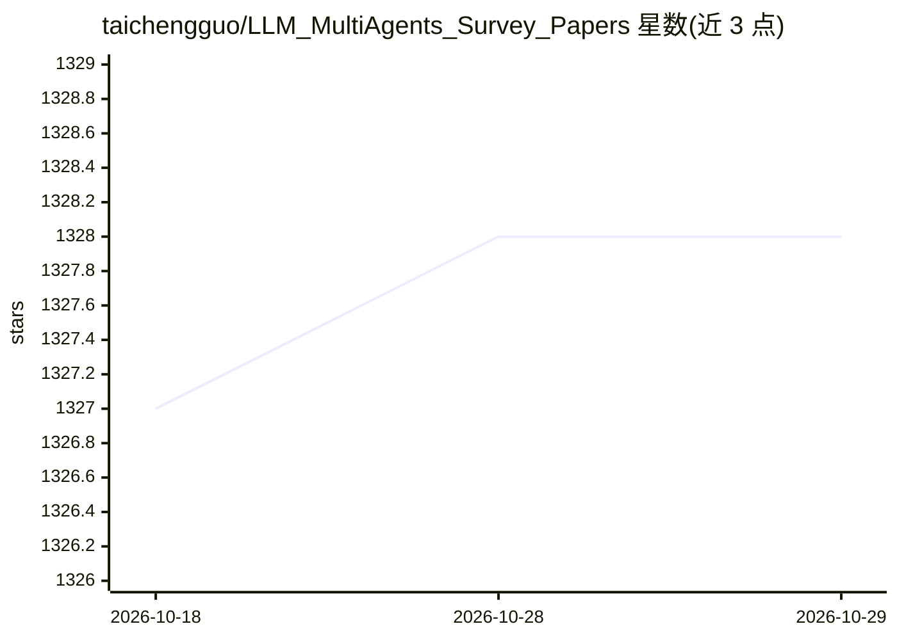

# taichengguo/LLM_MultiAgents_Survey_Papers

⭐ 1,328 · 推送 2026-10-25 · [GitHub](https://github.com/taichengguo/LLM_MultiAgents_Survey_Papers) · [官网](https://arxiv.org/abs/2402.01680) · 个人维护

**LLM 多智能体论文综述清单：附 IJCAI 2024 综述论文**

配套综述论文《Large Language Model based Multi-Agents: A Survey of Progress and Challenges》(IJCAI 2024) 的论文收录仓库，将 LLM 多智能体论文分为五大方向：框架、编排与效率、问题求解（含软件开发/具身智能/科学团队/科学辩论/数据库等子类）、世界模拟、数据集与基准。条目以时间排列，附 arXiv 论文链接，部分含代码链接；作者声明每两周更新一次并接受补充建议。无安装或运行内容，仅作文献索引使用。

## 筛选速览

| 维度 | 判定 | 备注 |
|---|---|---|
| AI 角色 | `ai-knowledge` | 知识聚合/清单类 |
| 许可风险 | `none` | — |
| 部署形态 | `None` |  |
| 模型依赖 | — | README 未给出锁定关系 |
| 硬件要求 | — | 无带数字的原话,不猜 |
| 安装摩擦 | `low` | 无编译、无系统依赖或容器化 |
| 成熟度 | — | 结构信号不足 |

## 能力要点

- 五大方向分类组织 LLM 多智能体论文（框架/编排效率/问题求解/世界模拟/数据集基准）
- 配套综述论文发表于 IJCAI 2024
- 条目附论文链接，部分附代码仓库链接
- 问题求解部分含软件开发、具身智能、科学团队、科学辩论、数据库等子类

## 适用场景

- 查找 LLM 多智能体各方向的代表性论文
- 跟踪该领域按时间线的论文进展
- 为研究选题做文献调研

## 场景标签

`科研工具` `精选清单` · 领域:学习与行业

## 证据(README 行号)

> L8: Our survey about LLM based Multi-Agents is available at: https://arxiv.org/abs/2402.01680
> L22: [2024/01] This repo is created to maintain LLM-based Multi-Agents papers. We categorized these papers into five mai

## 星数曲线

2026-10-18 1,327 → 2026-10-29 1,328（+1）

---
*卡片 v1 · prompt 1.4 · 生成 2026-10-21 · 置信度 high · 依据 README sha `14e281d8d315` · [字段定义](../../DATASET.md)*
