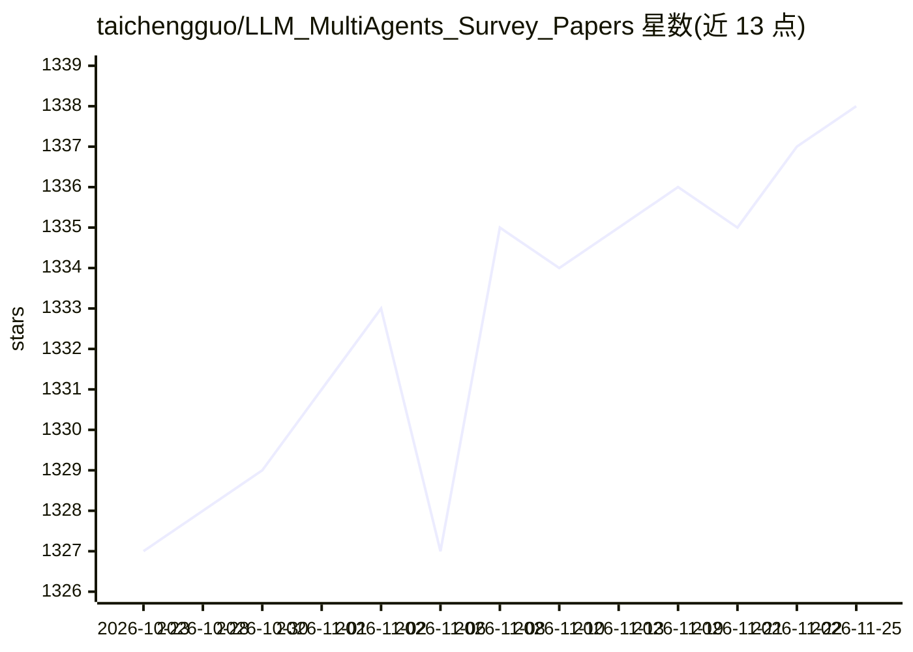

# taichengguo/LLM_MultiAgents_Survey_Papers

⭐ 1,338 · 推送 2026-11-21 · [GitHub](https://github.com/taichengguo/LLM_MultiAgents_Survey_Papers) · [官网](https://arxiv.org/abs/2402.01680) · 个人维护

**面向研究者的 LLM 多智能体论文分类清单**

该仓库维护基于 LLM 的多智能体研究论文列表，是 IJCAI 2024 综述论文（arXiv:2402.01680）的配套资源。论文按五条主线分类：多智能体框架、编排与效率、问题求解、世界模拟、数据集与基准。条目含论文链接与部分代码链接，仓库每两周更新一次。目录显示覆盖软件开发、具身智能体、科学实验、医疗决策等应用方向。

## 筛选速览

| 维度 | 判定 | 备注 |
|---|---|---|
| AI 角色 | `ai-knowledge` | 知识聚合/清单类 |
| 许可风险 | `none` | — |
| 部署形态 | `None` |  |
| 模型依赖 | — | README 未给出锁定关系 |
| 硬件要求 | — | 无带数字的原话,不猜 |
| 安装摩擦 | `low` | 无编译、无系统依赖或容器化 |
| 成熟度 | — | 结构信号不足 |

## 能力要点

- 配套 IJCAI 2024 综述论文（arXiv:2402.01680）
- 论文按五条研究主线分类组织
- 声明每两周更新论文列表
- 条目附论文与代码链接

## 适用场景

- 查找 LLM 多智能体领域的论文入门材料
- 按研究主线（框架/编排/求解/模拟/基准）梳理文献
- 寻找带开源代码的多智能体研究项目

## 场景标签

`精选清单` · 领域:学习与行业

## 证据(README 行号)

> L7: # 🔥Our Survey Paper
> L22: [2024/01] This repo is created to maintain LLM-based Multi-Agents papers. We categorized these papers into five mai
> L29: # 📌 Table of Content (ToC)

## 星数曲线

2026-10-23 1,327 → 2026-11-25 1,338（+11）

---
*卡片 v1 · prompt 1.4 · 生成 2026-11-23 · 置信度 high · 依据 README sha `879b268843d0` · [字段定义](../../DATASET.md)*
