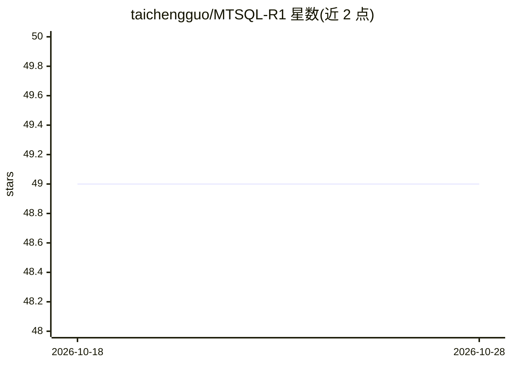

# taichengguo/MTSQL-R1

⭐ 49 · Python · Apache-2.0 · 推送 2026-05-15 · [GitHub](https://github.com/taichengguo/MTSQL-R1) · [官网](https://arxiv.org/abs/2510.12831) · 个人维护

**多轮 Text-to-SQL 的两阶段 Agentic 训练代码（ACL 2026 论文官方实现）**

基于 verl 构建的 Text-to-SQL 训练仓库：将多轮 Text-to-SQL 建模为长时程 agent 任务，模型通过数据库执行反馈与对话记忆校验来生成、验证并自我修正 SQL。训练分两阶段：Stage 1 用 LLaMA-Factory 做 Self-Taught Warm-Start SFT（高温采样、难度感知拒绝采样、工具集成轨迹），Stage 2 做课程式多轮端到端 RL（结果奖励与稠密过程奖励）。在 CoSQL/SParC 基准上提供 1.7B/4B 模型；运行需自行下载基准数据库、改写 reward 脚本中的数据库路径，并配置 GPU 环境（CUDA 12.4）。

## 筛选速览

| 维度 | 判定 | 备注 |
|---|---|---|
| AI 角色 | `ai-native` | 本体是模型或模型工具 |
| 许可风险 | `permissive` | Apache-2.0 |
| 部署形态 | `None` |  |
| 模型依赖 | — | README 未给出锁定关系 |
| 硬件要求 | — | 无带数字的原话,不猜 |
| 安装摩擦 | `medium` | 含编译或系统依赖之一 |
| 成熟度 | — | 结构信号不足 |

## 能力要点

- 长时程 formulation：SQL 生成伴随数据库执行反馈与显式记忆校验
- 两阶段训练：Self-Taught Warm-Start SFT + 课程式多轮 RL（结果与过程奖励）
- 提供 CoSQL/SParC 上 1.7B/4B 的 Hugging Face 模型
- 多轮 rollout、评测、checkpoint 转换等一整套 shell 脚本入口

## 适用场景

- 复现论文的多轮 Text-to-SQL 训练与评测流程
- 在 CoSQL/SParC 上做 RL 训练消融（结果奖励 vs 过程奖励）
- 基于该框架扩展自己的 agentic Text-to-SQL 训练方法

## 场景标签

`数据分析` `强化学习` · 领域:效率与自动化

## 证据(README 行号)

> L27: |LLM Training|🎓 **Two-Stage** Training Framework|1) **Tool-Integrated High-Quality SFT Dataset construction** by Se
> L155: ## Stage2: End-to-End Long-Horizon Reinforcement Learning

## 星数曲线

2026-10-18 49 → 2026-10-28 49（+0）

---
*卡片 v1 · prompt 1.4 · 生成 2026-10-24 · 置信度 high · 依据 README sha `a5d3fc84c401` · [字段定义](../../DATASET.md)*
