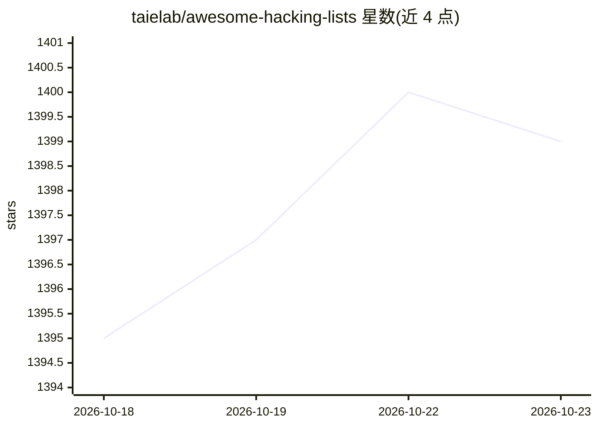

# taielab/awesome-hacking-lists

⭐ 1,399 · 推送 2025-12-04 · [GitHub](https://github.com/taielab/awesome-hacking-lists) · 个人维护 · 中文 README

**个人 GitHub stars 自动生成的安全工具与生产力资源清单**

由 starred 工具自动生成的个人收藏清单，按编程语言分类收录渗透测试、逆向工程、提权漏洞利用、eBPF、C2 框架、应急响应等安全工具，混有中文工具与字体、推送服务等杂项条目。条目仅含仓库名与一句话描述，不提供安装器或统一使用方式，面向浏览与发现仓库的场景。非人工策展，更新依赖个人 star 行为。

## 筛选速览

| 维度 | 判定 | 备注 |
|---|---|---|
| AI 角色 | `ai-knowledge` | 知识聚合/清单类 |
| 许可风险 | `none` | — |
| 部署形态 | `desktop` | 安装包/桌面程序 |
| 模型依赖 | — | README 未给出锁定关系 |
| 硬件要求 | — | 无带数字的原话,不猜 |
| 安装摩擦 | `high` | 编译与系统依赖俱全 |
| 成熟度 | — | 结构信号不足 |

## 能力要点

- 按 20+ 种编程语言分类组织条目
- 覆盖提权、免杀、C2、eBPF rootkit 等渗透测试方向
- 收录多个中文安全工具与资源

## 适用场景

- 按语言浏览发现安全工具仓库
- 查找提权/漏洞利用相关的 PoC 项目

## 场景标签

 · 领域:网络安全/工具清单

## 证据(README 行号)

> L1: # Awesome Stars Awesome
> L3: > A curated list of my GitHub stars! Generated by starred.

## 星数曲线

2026-10-18 1,395 → 2026-10-23 1,399（+4）

---
*卡片 v1 · prompt 1.4 · 生成 2026-10-21 · 置信度 low · 依据 README sha `c131f25f3e0b` · [字段定义](../../DATASET.md)*
