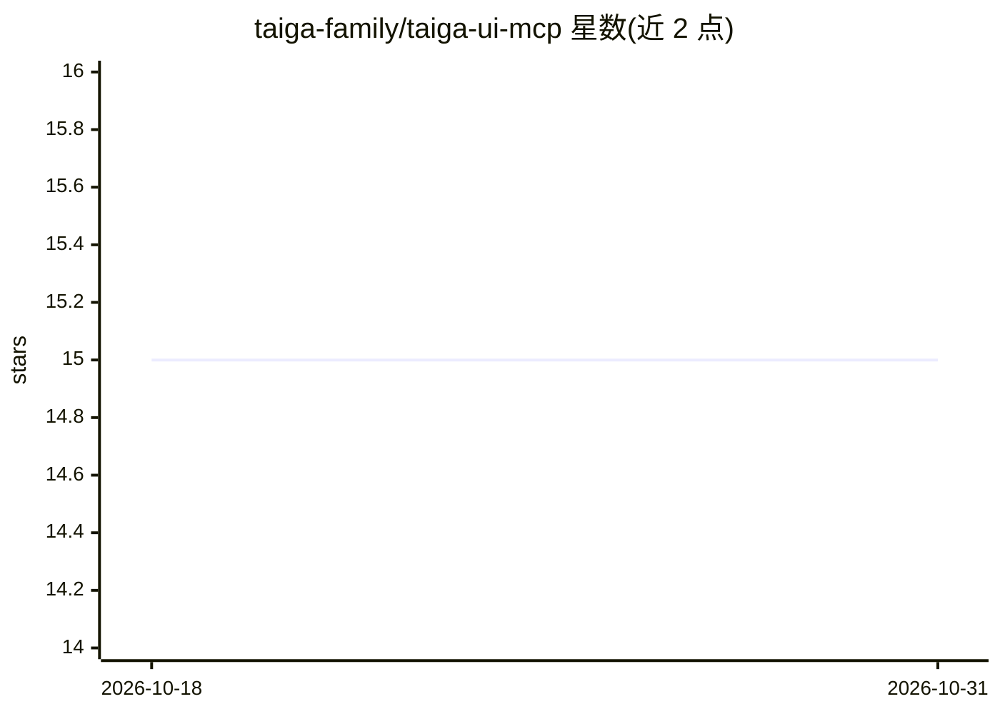

# taiga-family/taiga-ui-mcp

⭐ 15 · TypeScript · Apache-2.0 · 推送 2026-10-29 · [GitHub](https://github.com/taiga-family/taiga-ui-mcp) · [官网](https://www.npmjs.com/package/@taiga-ui/mcp) · 组织维护

**为 AI 助手提供 Taiga UI 组件文档检索的 MCP 服务器**

Taiga UI 家族维护的 Model Context Protocol 服务器，面向使用 Taiga UI（Angular 组件库）的开发者与 AI 编码助手。提供四个 MCP 工具：get_overview 返回导入映射与常见错误等结构化文档头、get_list_components 按模糊过滤列出组件、get_component_example 取回完整组件文档与代码示例、get_migration_guide 提供版本迁移指南。通过 npx @taiga-ui/mcp init 交互式或一行命令写入 VS Code、Cursor、Claude Desktop 等客户端配置，可选 v5/v4 文档版本，无需本地 Angular 安装。

## 筛选速览

| 维度 | 判定 | 备注 |
|---|---|---|
| AI 角色 | `ai-ecosystem` | LLM/agent 周边工具 |
| 许可风险 | `permissive` | Apache-2.0 |
| 部署形态 | `library` | 以包/库形式分发 |
| 模型依赖 | — | README 未给出锁定关系 |
| 硬件要求 | — | 无带数字的原话,不猜 |
| 安装摩擦 | `low` | 无编译、无系统依赖或容器化 |
| 成熟度 | — | 结构信号不足 |

## 能力要点

- 四个 MCP 工具覆盖概览、组件发现、示例获取与迁移指南
- 支持 v5 与 v4 文档版本选择，无需本地 Angular 安装
- npx init/remove 命令自动写入或移除多种 MCP 客户端配置

## 适用场景

- 在 AI 编码助手中检索 Taiga UI 组件文档与 Angular 示例
- 生成使用 Taiga UI 的 Angular 代码时获取正确导入映射与常见错误提示
- 查询 Taiga UI 大版本间的迁移指南

## 场景标签

 · 领域:前端开发工具/AI 接入

## 证据(README 行号)

> L8: A Model Context Protocol (MCP) server that provides AI assistants with comprehensive access to
> L15: - **Four MCP tools**. Get structured overview with `get_overview`, discover with `get_list_components`, fetch examp

## 星数曲线

2026-10-18 15 → 2026-10-31 15（+0）

---
*卡片 v1 · prompt 1.4 · 生成 2026-10-30 · 置信度 high · 依据 README sha `39dca859f994` · [字段定义](../../DATASET.md)*
