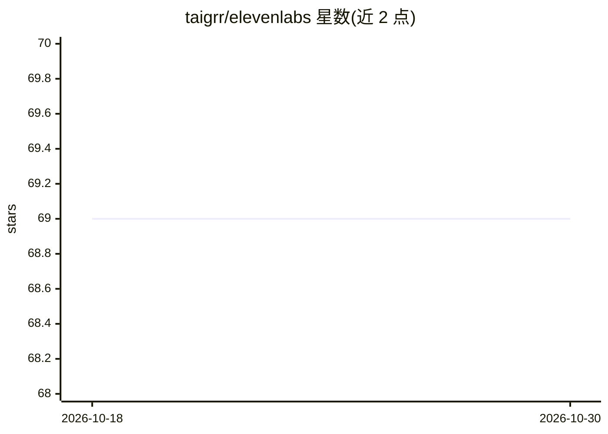

# taigrr/elevenlabs

⭐ 69 · Go · 0BSD · 推送 2026-10-23 · [GitHub](https://github.com/taigrr/elevenlabs) · [官网](https://pkg.go.dev/github.com/taigrr/elevenlabs) · 个人维护

**非官方 Go 客户端：调用 ElevenLabs 语音合成/转录 API**

面向 Go 开发者的非官方 ElevenLabs API 客户端库，覆盖文本转语音（TTS）、语音转文本、音效生成与语音管理接口。使用前提是已有 elevenlabs.io 账号并获取 API key，通过环境变量 XI_API_KEY 认证。提供 go install 安装的 say 测试程序，可直接管道输入文本播放；示例代码演示流式 TTS 与音效生成，支持保存 mp3。声明与 ElevenLabs 无隶属关系，许可为 0BSD。

## 筛选速览

| 维度 | 判定 | 备注 |
|---|---|---|
| AI 角色 | `ai-ecosystem` | LLM/agent 周边工具 |
| 许可风险 | `permissive` | 0BSD |
| 部署形态 | `library` | 以包/库形式分发 |
| 模型依赖 | — | README 未给出锁定关系 |
| 硬件要求 | — | 无带数字的原话,不猜 |
| 安装摩擦 | `low` | 无编译、无系统依赖或容器化 |
| 成熟度 | — | 结构信号不足 |

## 能力要点

- Go 语言封装 ElevenLabs TTS/STT/音效生成/语音管理 API
- 提供 say 命令行测试程序，管道输入文本即可合成
- 流式端点示例与音效生成示例

## 适用场景

- 在 Go 项目中集成 ElevenLabs 文本转语音
- 用 say 命令快速测试语音合成
- 程序化生成音效与管理语音库

## 场景标签

`语音合成` `语音识别` · 领域:内容生成

## 证据(README 行号)

> L9: Unofficial elevenlabs.io (11.ai) voice synthesis client
> L18: This go client provides an easy interface to create synthesized voices and

## 星数曲线

2026-10-18 69 → 2026-10-30 69（+0）

---
*卡片 v1 · prompt 1.4 · 生成 2026-10-24 · 置信度 high · 依据 README sha `76c0daa9895d` · [字段定义](../../DATASET.md)*
