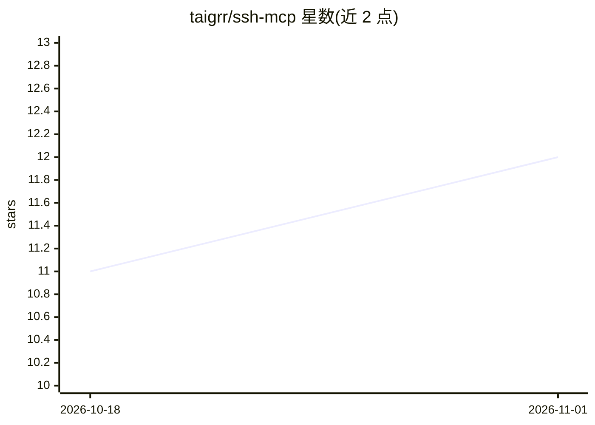

# taigrr/ssh-mcp

⭐ 12 · Go · 0BSD · 推送 2026-10-23 · [GitHub](https://github.com/taigrr/ssh-mcp) · [官网](https://pkg.go.dev/github.com/taigrr/ssh-mcp) · 个人维护

**给 AI 编程 agent 提供持久 SSH 会话的 MCP 服务器**

用 Go 编写的 Model Context Protocol 服务器：让 Claude Code、Claude Desktop、Crush 等 AI 编程 agent 通过 MCP 工具直接 SSH 到远程主机。从 ~/.ssh/config 解析主机别名，经 ssh-agent/gpg-agent 或密钥文件认证，提供 PTY 虚拟终端仿真、阻塞/非阻塞命令执行、SFTP 双向文件传输与远程文件编辑。访问受 --allowed-hosts 白名单限制，每会话单一持久 shell，同一会话同时仅允许一个 ssh_exec。经 go install 安装，无桌面构建。

## 筛选速览

| 维度 | 判定 | 备注 |
|---|---|---|
| AI 角色 | `ai-ecosystem` | LLM/agent 周边工具 |
| 许可风险 | `permissive` | 0BSD |
| 部署形态 | `library` | 以包/库形式分发 |
| 模型依赖 | — | README 未给出锁定关系 |
| 硬件要求 | — | 无带数字的原话,不猜 |
| 安装摩擦 | `low` | 无编译、无系统依赖或容器化 |
| 成熟度 | — | 结构信号不足 |

## 能力要点

- 15 个 MCP 工具：连接/执行/虚拟终端/键盘输入/SFTP 读写与传输/会话管理
- 仅允许白名单主机连接，从 ~/.ssh/config 解析连接参数
- ssh_exec 阻塞至完成或超时（默认 60s，上限 10m），超时不杀进程且返回屏幕快照
- 每会话单一 shell，写入经串行化路径，并发工具调用按规则拒绝

## 适用场景

- 让 Claude Code 等 agent 在远程服务器上执行构建、调试与运维操作
- 通过虚拟终端操作远程 TUI 程序（vim、htop、tmux）
- 用 SFTP 在本地与远程主机间传输文件、读写或精确编辑远程文件

## 场景标签

 · 领域:开发者工具/MCP 基础设施

## 证据(README 行号)

> L8: MCP server providing persistent SSH sessions for AI coding agents via the Model Context Protocol.
> L16: **ssh-mcp** gives your AI agent direct SSH access to an allowed set of hosts. It resolves connections from `~/.ssh/

## 星数曲线

2026-10-18 11 → 2026-11-01 12（+1）

---
*卡片 v1 · prompt 1.4 · 生成 2026-10-31 · 置信度 high · 依据 README sha `730a4cde8fcc` · [字段定义](../../DATASET.md)*
