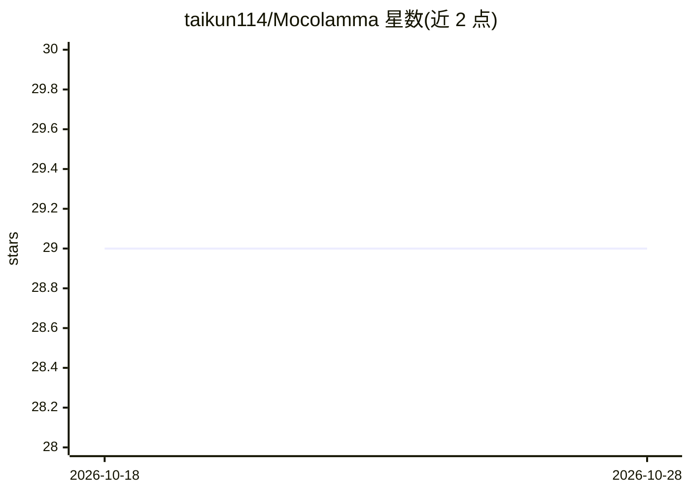

# taikun114/Mocolamma

⭐ 29 · Swift · MIT · 推送 2026-10-28 · [GitHub](https://github.com/taikun114/Mocolamma) · [官网](https://mocolamma.taikun.design/) · 个人维护

**跨苹果平台管理 Ollama 服务器与模型并进行聊天测试的客户端**

面向 macOS / iOS / iPadOS / visionOS 的非官方 Ollama 管理应用：通过本地网络连接 Ollama 服务器，提供服务器增删编辑、模型查看/下载、简单聊天测试与图像生成四个功能页。聊天页不保存消息记录，用于测试下载的模型；需另备 Ollama 服务器，图像生成依赖 Ollama 处于 beta 的接口且服务器需 Apple silicon Mac。免费版仅 macOS（GitHub releases），付费版 $1.99 上架 App Store 覆盖全部平台，功能相同。

## 筛选速览

| 维度 | 判定 | 备注 |
|---|---|---|
| AI 角色 | `ai-ecosystem` | LLM/agent 周边工具 |
| 许可风险 | `permissive` | MIT |
| 部署形态 | `desktop` | 安装包/桌面程序 |
| 模型依赖 | local-ok | 支持本地模型 |
| 硬件要求 | — | 无带数字的原话,不猜 |
| 安装摩擦 | `low` | 无编译、无系统依赖或容器化 |
| 成熟度 | `idea` | |

## 能力要点

- 服务器/模型/聊天/图像生成四页管理 Ollama 服务器与模型
- macOS 默认注册 localhost 服务器，本机 Ollama 可即开即用
- macOS 免费版与 App Store 付费版（$1.99，全平台通用购买）
- 声明不收集用户信息

## 适用场景

- 在 Mac/iPhone/iPad/Vision Pro 上管理本地网络中的 Ollama 服务器与模型
- 下载模型后做简单聊天测试验证效果
- 调用 Ollama 图像模型生成图片并保存/分享

## 场景标签

`聊天机器人` `图像生成` · 领域:对话与助手

## 证据(README 行号)

> L27: Mocolamma is an **Ollama** management application for macOS, iOS / iPadOS and visionOS that connects to Ollama serv
> L62: > Ollama is not included with Mocolamma. A separate Ollama server is required to use most of Mocolamma's features.\
> L82: Mocolamma can connect to Ollama servers on networks to manage models and perform simple chats using the models.

## 星数曲线

2026-10-18 29 → 2026-10-28 29（+0）

---
*卡片 v1 · prompt 1.4 · 生成 2026-10-26 · 置信度 high · 依据 README sha `c87b32474ec3` · [字段定义](../../DATASET.md)*
