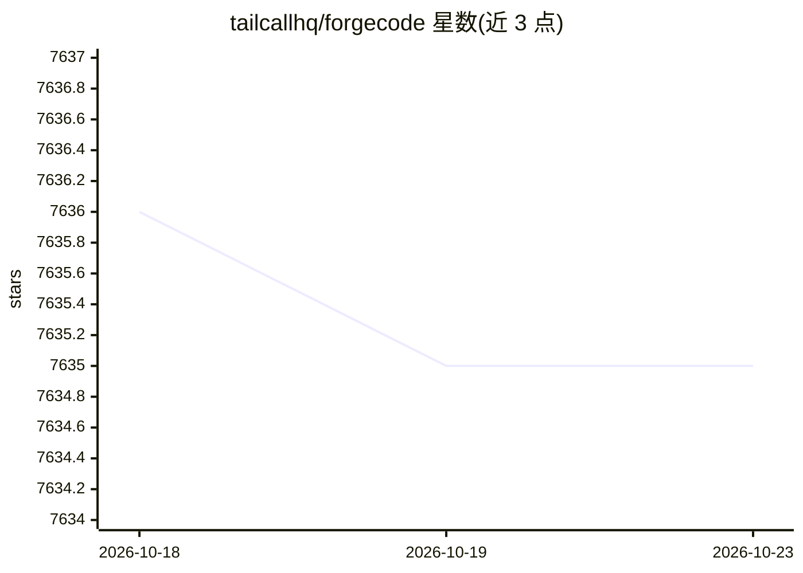

# tailcallhq/forgecode

⭐ 7,635 · Rust · Apache-2.0 · 推送 2026-10-22 · [GitHub](https://github.com/tailcallhq/forgecode) · [官网](https://forgecode.dev) · 组织维护

**终端 AI 结对编程工具：对话式读写代码、提交与语义检索**

运行在终端中的编码 agent（CLI/TUI），通过接入 OpenAI、Anthropic 等 LLM 提供商，在会话中读取文件、写补丁、执行命令并保持上下文。提供三种使用方式：交互式 TUI、一次性 `-p` CLI 模式、以及 ZSH 插件的 `:` 前缀命令系统。内置 forge/sage/muse 三个 agent（实现、只读研究、规划），支持自定义 agent、SKILL.md 技能、AGENTS.md 持久指令与代码库语义索引；含受限 shell 沙箱模式与 git 集成（AI 生成 commit 信息）。面向希望在工作流中引入 AI 辅助的开发者。

## 筛选速览

| 维度 | 判定 | 备注 |
|---|---|---|
| AI 角色 | `ai-ecosystem` | LLM/agent 周边工具 |
| 许可风险 | `permissive` | Apache-2.0 |
| 部署形态 | `None` |  |
| 模型依赖 | — | README 未给出锁定关系 |
| 硬件要求 | — | 无带数字的原话,不猜 |
| 安装摩擦 | `low` | 无编译、无系统依赖或容器化 |
| 成熟度 | — | 结构信号不足 |

## 能力要点

- 三种模式：交互式 TUI、一次性 CLI、ZSH `:` 前缀插件
- 内置 forge/sage/muse 三种角色 agent，支持自定义 agent 与 SKILL.md 技能
- AI 读取 diff 生成 commit 信息、自然语言转 shell 命令
- 代码库语义索引（:sync），可自托管 workspace 服务器

## 适用场景

- 在终端里让 AI 解释、重构或实现项目功能
- 用自然语言生成 commit 信息与 PR 描述
- 通过 ZSH 前缀命令快速发送提示词而不离开 shell

## 场景标签

`编码 Agent` `语义搜索` · 领域:编码与开发

## 证据(README 行号)

> L110: - **Multi-provider support** - Use OpenAI, Anthropic, or other LLM providers
> L118: Forge has three distinct ways to use it. Understanding this distinction upfront will save you confusion.
> L122: Running `forge` with no arguments starts the interactive terminal UI, a persistent session where you type prompts 

## 星数曲线

2026-10-18 7,636 → 2026-10-23 7,635（-1）

---
*卡片 v1 · prompt 1.4 · 生成 2026-10-20 · 置信度 mid · 依据 README sha `2886080376c8` · [字段定义](../../DATASET.md)*
