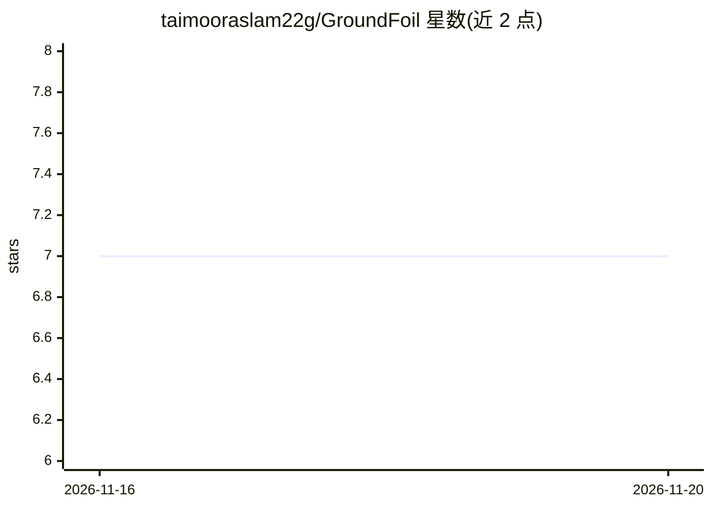

# taimooraslam22g/GroundFoil

⭐ — · [GitHub]() · 个人维护

**科研复现项目：用 U-Net 预测地面效应倒置翼型（F1 前翼）流场**

GroundFoil 是围绕 Thuerey 等 2020 年翼型流场深度学习论文的研究复现与扩展项目：先用 OpenFOAM v2606 与 gmsh 复现原自由流研究，再扩展到地面效应倒置翼型，生成 4000 次 RANS 运行组成的数据集，训练 U-Net 预测翼型周围压力与速度场，并另设两个分别只预测下压力与沿翼面压力分布的小网络。结果经 LES、风洞数据与网格研究交叉验证。使用者是 CFD/深度学习研究者，工作流分为 15 步并各有文档页。

## 筛选速览

| 维度 | 判定 | 备注 |
|---|---|---|
| AI 角色 | `ai-native` | 本体是模型或模型工具 |
| 许可风险 | `permissive` | — |
| 部署形态 | `self-host` | docker 或自建部署 |
| 模型依赖 | — | README 未给出锁定关系 |
| 硬件要求 | — | 无带数字的原话,不猜 |
| 安装摩擦 | `low` | 无编译、无系统依赖或容器化 |
| 成熟度 | `idea` | |

## 能力要点

- U-Net 在 28 个未见翼型上预测流场，误差 0.9%
- 包含 4000 次 RANS 运行、覆盖 1,286 个翼型的数据集
- 复现 Thuerey et al. (2020) 自由流研究，测试误差 2.96%（原文 2.6%）
- 提供仅预测下压力的小网络（误差 1.6%）与沿翼面压力/摩擦模型

## 适用场景

- 复现或扩展翼型流场深度学习预测研究
- 快速估计 F1 前翼在不同离地高度下的下压力
- 构建地面效应翼型的 RANS 仿真数据集

## 场景标签

`科研工具` · 领域:学习与行业

## 证据(README 行号)

> L5: **GroundFoil** predicts the flow around **inverted airfoils in ground effect**
> L14: Trained on 3,096 of these simulations, the U-Net predicts the flow around 28
> L60: 8. **U-Net learning curve:** with 789 samples

## 星数曲线

2026-11-16 7 → 2026-11-20 7（+0）

---
*卡片 v1 · prompt 1.4 · 生成 2026-11-20 · 置信度 high · 依据 README sha `c4d662fcb045` · [字段定义](../../DATASET.md)*
