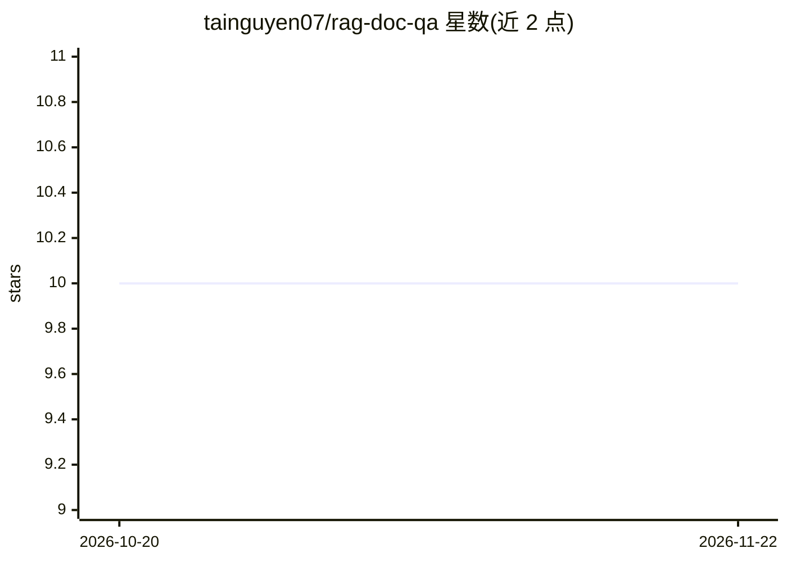

# tainguyen07/rag-doc-qa

⭐ 10 · Python · MIT · 推送 2026-08-21 · [GitHub](https://github.com/tainguyen07/rag-doc-qa) · 个人维护

**面向开发者的引用溯源 RAG 文档问答系统**

生产风格 RAG 文档问答工程：LangChain 摄取 PDF/DOCX/HTML/Markdown/Notion/Confluence 等格式，分块后写入可插拔向量库（Chroma 本地 / pgvector 生产），检索采用 BM25 与稠密向量 RRF 融合、可选交叉编码器重排；每条回答带 [doc_id:chunk_id] 引用标记，置信度低于阈值时拒答。FastAPI 以 SSE 流式提供对话 API 与内置聊天 UI，附带 ingest/query/serve/evaluate/bench CLI、ragas 评测与三套 YAML 配置。安装需 Python 3.11+，pgvector 后端需 Postgres 15+。

## 筛选速览

| 维度 | 判定 | 备注 |
|---|---|---|
| AI 角色 | `ai-native` | 本体是模型或模型工具 |
| 许可风险 | `permissive` | MIT |
| 部署形态 | `library` | 以包/库形式分发 |
| 模型依赖 | — | README 未给出锁定关系 |
| 硬件要求 | — | 无带数字的原话,不猜 |
| 安装摩擦 | `medium` | 含编译或系统依赖之一 |
| 成熟度 | — | 结构信号不足 |

## 能力要点

- 混合检索：BM25 + 稠密嵌入经 RRF 融合，可选 cross-encoder 重排
- 引用溯源：回答绑定 [doc_id:chunk_id] 标记，低置信度拒答
- 双向量库可切换：Chroma（本地零配置）/ pgvector（生产 Postgres）
- ragas 评测集成与 CLI 基准测试命令

## 适用场景

- 对内部文档库搭建带引用来源的问答服务
- 本地开发用 Chroma、生产切到 pgvector 的部署演进
- 按 ragas 指标对比不同嵌入模型与分块大小

## 场景标签

`模型评测` `文档问答` `RAG` · 领域:评测与运维

## 证据(README 行号)

> L3: > Production-style Retrieval-Augmented Generation document Q&A: LangChain ingestion, hybrid retrieval, citation-grou
> L14: Most "RAG demos" stop at *vector search + a prompt*. Real document Q&A needs three things the demos skip: **hybrid 
> L21: - **Citation grounding** — every claim links to `[doc_id:chunk_id]` markers that survive streaming; refusals when r

## 星数曲线

2026-10-20 10 → 2026-11-22 10（+0）

---
*卡片 v1 · prompt 1.4 · 生成 2026-11-19 · 置信度 high · 依据 README sha `d5d68de00b4b` · [字段定义](../../DATASET.md)*
