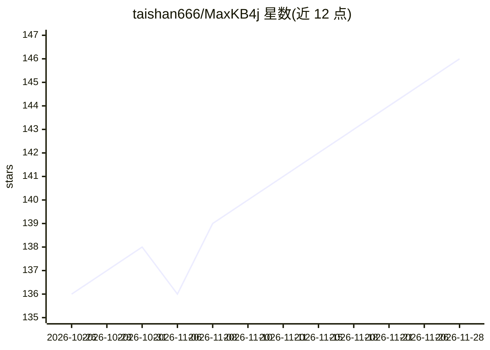

# taishan666/MaxKB4j

⭐ 146 · Java · GPL-3.0 · 推送 2026-11-27 · [GitHub](https://github.com/taishan666/MaxKB4j) · [官网](http://tarzan.blog.csdn.net/) · 个人维护 · 中文 README

**Java 团队的开源 LLMOps 平台：RAG 与可视化工作流引擎**

基于 Java 21 + Spring Boot 3（Virtual Threads）与 LangChain4j 构建的 LLM 工作流与 RAG 平台，参考 MaxKB、Dify、FastGPT 设计。功能覆盖知识库问答（文档解析→分块→向量化→混合检索→Reranker）、30+ 节点类型的可视化工作流编排、多 Agent 协作、Cron/Webhook 触发器，以及 ASR/TTS/OCR/Stable Diffusion 多模态能力。模型无关，可接私有模型与公有 API。需 Java 21、PostgreSQL（pgvector）与 MongoDB，提供 Docker、安装脚本与源码构建四种部署方式。Web 控制台源码不随仓库分发，按商业许可单独授权。

## 筛选速览

| 维度 | 判定 | 备注 |
|---|---|---|
| AI 角色 | `ai-ecosystem` | LLM/agent 周边工具 |
| 许可风险 | `viral` | GPL-3.0 |
| 部署形态 | `self-host` | docker 或自建部署 |
| 模型依赖 | local-ok | 支持本地模型 |
| 硬件要求 | — | 无带数字的原话,不猜 |
| 安装摩擦 | `low` | 无编译、无系统依赖或容器化 |
| 成熟度 | — | 结构信号不足 |

## 能力要点

- 生产级 RAG 流水线：解析→分块→向量化→混合检索→重排序，答案可溯源
- 30+ 节点类型的低代码可视化工作流与多 Agent 协作（共享内存总线）
- 文本+图像融合 embedding 的图文混合检索，内置 ASR/TTS/OCR/Stable Diffusion
- RESTful API、iframe/Web SDK 嵌入、OpenAI 兼容接口与 MCP 集成

## 适用场景

- 搭建企业内部知识库问答与智能客服
- 为业务流程编排可视化 LLM 工作流与定时任务
- 接入私有模型构建数据不出域的 RAG 应用
- Java 团队避免跨语言栈维护 LLM 应用

## 场景标签

`RAG` `工作流自动化` `文档问答` `多智能体` · 领域:Agent 开发

## 证据(README 行号)

> L6:  An out-of-the-box, model-agnostic RAG + LLM workflow engine built on Java 21 + Spring Boot 3 (Virtual Threads)
> L43: |🌐 Model-Agnostic|Private models via Ollama / Xorbits Inference / LocalAI; public models: Qwen, DeepSeek, Doubao, H
> L51: |Capability|**MaxKB4j**|Dify|MaxKB|FastGPT|RAGFlow|

## 星数曲线

2026-10-26 136 → 2026-11-28 146（+10）

---
*卡片 v1 · prompt 1.4 · 生成 2026-11-27 · 置信度 high · 依据 README sha `bd0a798642de` · [字段定义](../../DATASET.md)*
