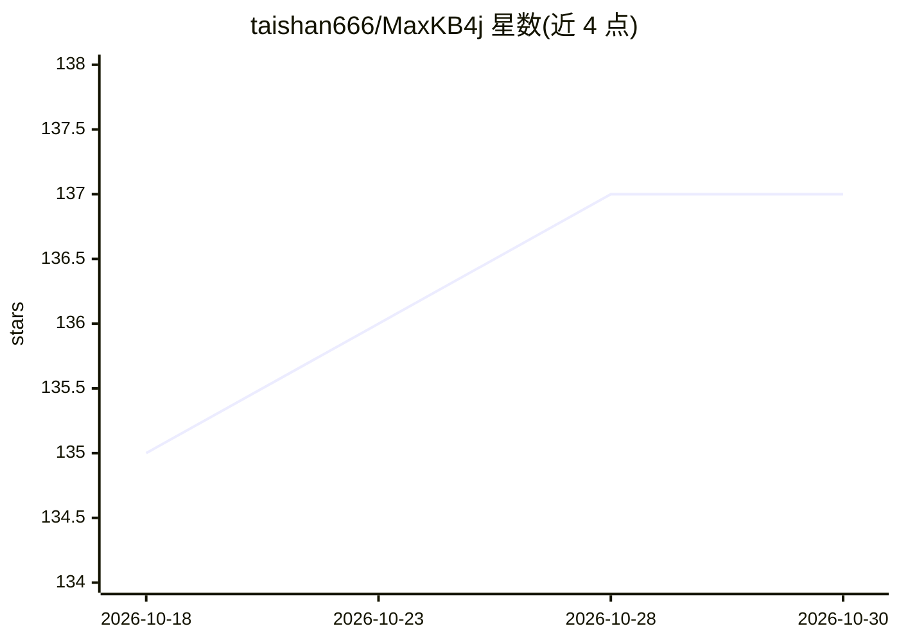

# taishan666/MaxKB4j

⭐ 137 · Java · GPL-3.0 · 推送 2026-10-29 · [GitHub](https://github.com/taishan666/MaxKB4j) · [官网](http://tarzan.blog.csdn.net/) · 个人维护 · 中文 README

**Java 技术栈的 LLMOps 平台：RAG 知识库与可视化工作流引擎**

基于 Java 21 + Spring Boot 3（虚拟线程）的 LLMOps 应用平台，面向 Java 团队提供 RAG 与 LLM 工作流能力：文档解析→分块→向量化→混合检索→Reranker 重排的知识库问答管线、30+ 节点的可视化工作流、多 Agent 协作、Cron/Webhook 触发器与 MCP 集成。模型接入支持 Ollama/LocalAI 等私有模型及 Qwen、GPT、Claude、Gemini 等公共模型。README 声称借鉴 MaxKB、Dify 与 FastGPT 并给出能力对比表。由独立开发者维护，无商业资助，通过 Docker Compose、单容器、一键脚本或源码构建部署。

## 筛选速览

| 维度 | 判定 | 备注 |
|---|---|---|
| AI 角色 | `ai-ecosystem` | LLM/agent 周边工具 |
| 许可风险 | `viral` | GPL-3.0 |
| 部署形态 | `self-host` | docker 或自建部署 |
| 模型依赖 | local-ok | 支持本地模型 |
| 硬件要求 | — | 无带数字的原话,不猜 |
| 安装摩擦 | `low` | 无编译、无系统依赖或容器化 |
| 成熟度 | — | 结构信号不足 |

## 能力要点

- 30+ 节点可视化工作流与多 Agent 协作
- RAG 管线：分块→向量化→混合检索→Reranker 重排，答案可溯源
- 文内图文融合向量，支持文搜图/图搜文
- 模型无关：Ollama/LocalAI 私有模型与多家公共模型接入

## 适用场景

- Java 团队在不引入 Python/TS 栈的前提下搭建企业知识库问答
- 通过可视化工作流编排客服、数据分析等业务流程
- 企业私有部署的智能客服与内部知识问答

## 场景标签

`RAG` `文档问答` `工作流自动化` `多智能体` · 领域:Agent 开发

## 证据(README 行号)

> L6:  An out-of-the-box, model-agnostic RAG + LLM workflow engine built on Java 21 + Spring Boot 3 (Virtual Threads)
> L37: |⚙️ Visual Workflow|Low-code orchestration with 30+ node types: conditional branches, loops, variable aggregation, 
> L41: |🧩 Seamless Integration|RESTful API, iframe / Web SDK embedding, OpenAI-compatible chat API, and stream_http MCP ag

## 星数曲线

2026-10-18 135 → 2026-10-30 137（+2）

---
*卡片 v1 · prompt 1.4 · 生成 2026-10-22 · 置信度 high · 依据 README sha `2133430c0e18` · [字段定义](../../DATASET.md)*
