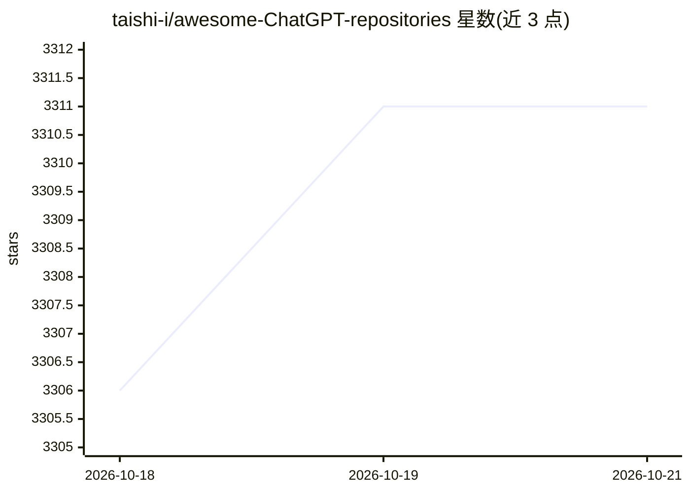

# taishi-i/awesome-ChatGPT-repositories

⭐ 3,311 · Python · CC0-1.0 · 推送 2026-10-19 · [GitHub](https://github.com/taishi-i/awesome-ChatGPT-repositories) · [官网](https://huggingface.co/spaces/taishi-i/awesome-ChatGPT-repositories-search) · 个人维护

**ChatGPT/OpenAI 相关开源仓库策展清单（2733 条）**

策展型 awesome 清单：收录与 ChatGPT、OpenAI API、Codex 相关的开源 GitHub 仓库共 2733 条，按 Chatbots、Browser-extensions、CLIs、NLP、Others 等类别组织，含最新收录与更新日期。提供可在 Claude Code、Codex 中安装的搜索技能插件，以及通过 npx skills 兼容 Cursor、Gemini CLI、GitHub Copilot 等代理的通用安装方式，支持按类别、语言过滤与多语言查询的评分排序搜索；另有 Hugging Face Spaces 上的网页搜索工具。面向开发者与 AI 生态选型场景。

## 筛选速览

| 维度 | 判定 | 备注 |
|---|---|---|
| AI 角色 | `ai-knowledge` | 知识聚合/清单类 |
| 许可风险 | `viral` | CC0-1.0 |
| 部署形态 | `library` | 以包/库形式分发 |
| 模型依赖 | — | README 未给出锁定关系 |
| 硬件要求 | — | 无带数字的原话,不猜 |
| 安装摩擦 | `low` | 无编译、无系统依赖或容器化 |
| 成熟度 | — | 结构信号不足 |

## 能力要点

- 收录 2733 个 ChatGPT/OpenAI 相关开源仓库并按类别组织
- 提供 Claude Code / Codex 插件形式的仓库搜索技能
- npx skills 安装方式兼容 Cursor、Gemini CLI、GitHub Copilot 等代理
- 支持按类别/语言过滤与多语言查询的评分排序

## 适用场景

- 我想为 agent 框架查找 RAG、agent 库或 CLI 类开源项目
- 按编程语言或类别筛选 ChatGPT 生态相关工具
- 直接在 Claude Code/Codex 会话中搜索清单收录的仓库

## 场景标签

`精选清单` · 领域:学习与行业

## 证据(README 行号)

> L11: A curated list of resources dedicated to open source GitHub repositories related to ChatGPT.
> L105: _Updated on October 16, 2026_ (A total of 2733 repositories listed.)
> L18: Search 2,500+ curated repositories directly from Claude Code or Codex — no browser needed, just describe what you'r

## 星数曲线

2026-10-18 3,306 → 2026-10-21 3,311（+5）

---
*卡片 v1 · prompt 1.4 · 生成 2026-10-20 · 置信度 high · 依据 README sha `676f5f5b2426` · [字段定义](../../DATASET.md)*
