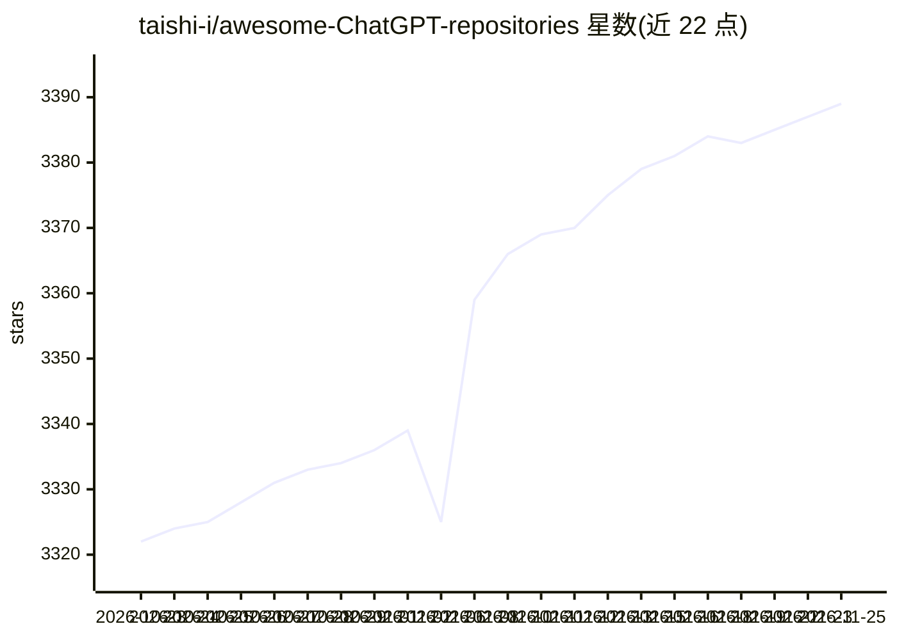

# taishi-i/awesome-ChatGPT-repositories

⭐ 3,389 · Python · CC0-1.0 · 推送 2026-11-22 · [GitHub](https://github.com/taishi-i/awesome-ChatGPT-repositories) · [官网](https://huggingface.co/spaces/taishi-i/awesome-ChatGPT-repositories-search) · 个人维护

**ChatGPT 相关开源仓库策展清单，可通过 Claude Code/Codex 技能检索**

收录与 ChatGPT、OpenAI API、Codex 相关的开源 GitHub 仓库的策展清单，共 2,755 条，按 Chatbots、Browser-extensions、CLIs、NLP、Others 等类别组织，并以 Awesome-lists 等分节维护。除网页浏览外，提供 Claude Code 与 Codex 插件形式的检索技能，支持按类别、编程语言过滤与多语言查询，结果按相关性、star 数与项目质量排序；其他 agent 可通过 npx skills 安装。另有 Hugging Face Spaces 上的检索工具。

## 筛选速览

| 维度 | 判定 | 备注 |
|---|---|---|
| AI 角色 | `ai-knowledge` | 知识聚合/清单类 |
| 许可风险 | `viral` | CC0-1.0 |
| 部署形态 | `library` | 以包/库形式分发 |
| 模型依赖 | — | README 未给出锁定关系 |
| 硬件要求 | — | 无带数字的原话,不猜 |
| 安装摩擦 | `low` | 无编译、无系统依赖或容器化 |
| 成熟度 | — | 结构信号不足 |

## 能力要点

- 收录 2,755 个 ChatGPT/OpenAI API/Codex 相关开源仓库并按类别组织
- 提供 Claude Code/Codex 插件技能，从 agent 内直接检索，无需浏览器
- 支持按类别（如 CLIs、NLP）、编程语言过滤与日/中/韩等多语言查询
- 结果按相关性、star 数与项目质量排序，并持续更新

## 适用场景

- 为项目查找 RAG 框架、agent 库、chatbot UI、CLI 工具等仓库
- 在 Claude Code/Codex 中用自然语言检索相关开源项目
- 按类别或语言筛选特定领域的 LLM 工具清单

## 场景标签

`精选清单` · 领域:学习与行业

## 证据(README 行号)

> L11: A curated list of resources dedicated to open source GitHub repositories related to ChatGPT.
> L18: Search 2,500+ curated repositories directly from Claude Code or Codex — no browser needed, just describe what you'r

## 星数曲线

2026-10-23 3,322 → 2026-11-25 3,389（+67）

---
*卡片 v1 · prompt 1.4 · 生成 2026-11-23 · 置信度 high · 依据 README sha `b9e871e30d10` · [字段定义](../../DATASET.md)*
