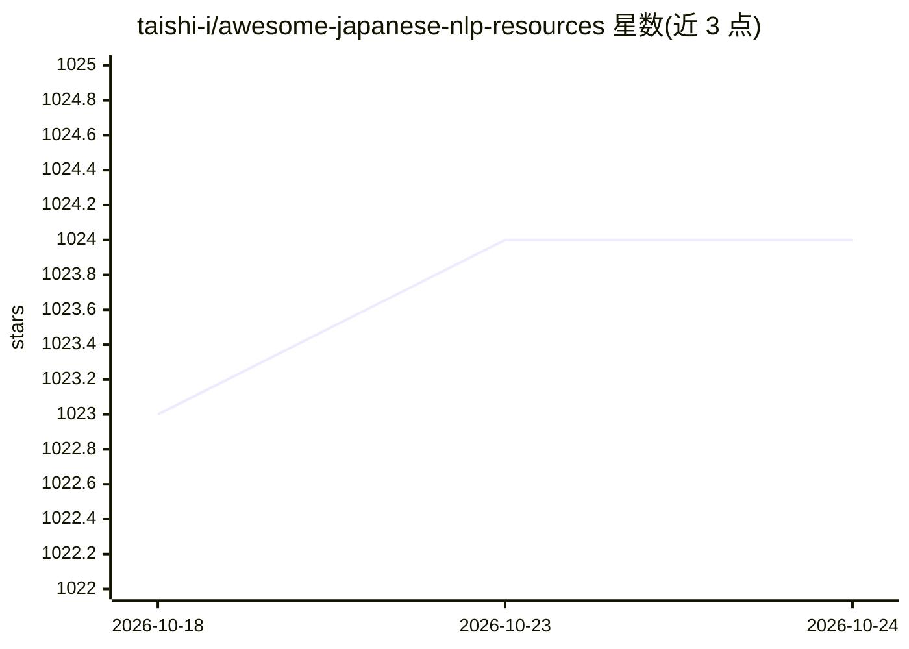

# taishi-i/awesome-japanese-nlp-resources

⭐ 1,024 · CC0-1.0 · 推送 2026-10-23 · [GitHub](https://github.com/taishi-i/awesome-japanese-nlp-resources) · [官网](https://taishi-i.github.io/awesome-japanese-nlp-resources/) · 个人维护 · 中文 README

**日语 NLP 资源策展清单（898 GitHub + 454 Hugging Face 仓库）**

面向日语自然语言处理的资源聚合清单：收录 898 个 GitHub 仓库与 454 个 Hugging Face 模型/数据集，另含 156 个支持日语的多语言资源；按形态学分析、句法解析、转换器、预处理、句子切分等类别组织，每类附下载量、star 数与最近提交时间的统计表。同时以 Claude Code / Codex 插件形式提供四个技能（search/discover/compare/research），可检索内置的 1,200+ 资源数据集。

## 筛选速览

| 维度 | 判定 | 备注 |
|---|---|---|
| AI 角色 | `ai-knowledge` | 知识聚合/清单类 |
| 许可风险 | `viral` | CC0-1.0 |
| 部署形态 | `None` |  |
| 模型依赖 | — | README 未给出锁定关系 |
| 硬件要求 | — | 无带数字的原话,不猜 |
| 安装摩擦 | `low` | 无编译、无系统依赖或容器化 |
| 成熟度 | — | 结构信号不足 |

## 能力要点

- 收录 898 个 GitHub 仓库与 454 个 Hugging Face 仓库
- 按功能类别组织并附下载量/star/活跃度统计表
- Claude Code 与 Codex 插件提供 search/discover/compare/research 四个技能
- 插件按查询语言自动切换英文/日文回复

## 适用场景

- 为日语 NLP 项目挑选形态学分析或分词库
- 查找日语 LLM、词典与语料数据集
- 在 Claude Code 或 Codex 内直接检索与对比候选资源

## 场景标签

`精选清单` · 领域:学习与行业

## 证据(README 行号)

> L8: A curated list of resources dedicated to Python libraries, llms, dictionaries, and corpora of NLP for Japanese
> L10: - Listed information on 898 GitHub repositories
> L11: - Listed information on 454 Hugging Face repositories (models and datasets)

## 星数曲线

2026-10-18 1,023 → 2026-10-24 1,024（+1）

---
*卡片 v1 · prompt 1.4 · 生成 2026-10-21 · 置信度 high · 依据 README sha `e53ef7032063` · [字段定义](../../DATASET.md)*
