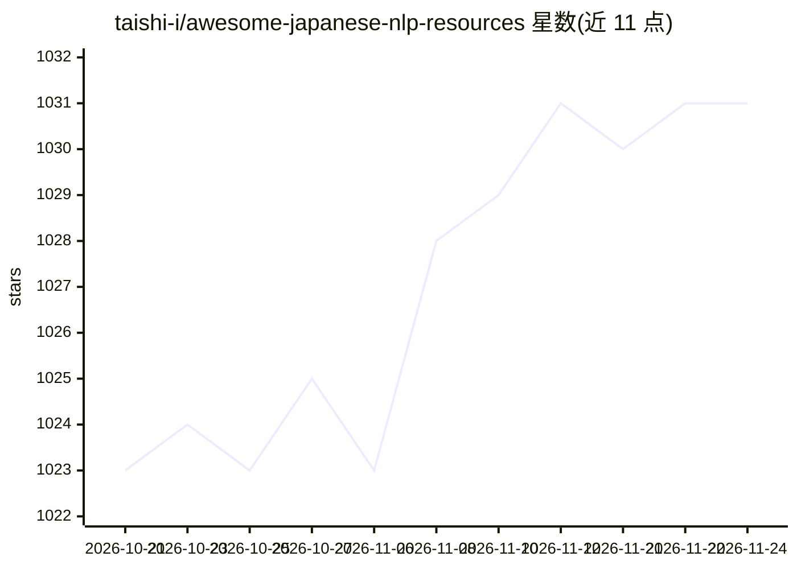

# taishi-i/awesome-japanese-nlp-resources

⭐ 1,032 · CC0-1.0 · 推送 2026-11-23 · [GitHub](https://github.com/taishi-i/awesome-japanese-nlp-resources) · [官网](https://awesome-japanese-nlp.org) · 个人维护

**日语 NLP 资源策展清单：收录 898 个 GitHub 仓库与 497 个 Hugging Face 条目**

面向日语自然语言处理的资源清单，收录 Python 库、LLM、词典、语料与数据集，覆盖 898 个 GitHub 仓库、497 个 Hugging Face 模型/数据集及 158 个多语言资源。条目按词法分析、句法解析、字符转换、文本预处理、分句等任务分类，并附每周下载量、星标数与最近提交时间统计表。另提供 Claude Code 与 Codex 插件，捆绑 1,450+ 资源数据集，支持 search/discover/compare/research 四个技能命令，按查询语言回复。以 CC0-1.0 许可发布，并有按任务与热度浏览的配套网站。

## 筛选速览

| 维度 | 判定 | 备注 |
|---|---|---|
| AI 角色 | `ai-knowledge` | 知识聚合/清单类 |
| 许可风险 | `viral` | CC0-1.0 |
| 部署形态 | `None` |  |
| 模型依赖 | — | README 未给出锁定关系 |
| 硬件要求 | — | 无带数字的原话,不猜 |
| 安装摩擦 | `low` | 无编译、无系统依赖或容器化 |
| 成熟度 | — | 结构信号不足 |

## 能力要点

- 收录 898 个 GitHub 仓库与 497 个 Hugging Face 模型/数据集条目
- 按形态分析、解析、转换、预处理、分句等 NLP 任务分类组织
- Claude Code/Codex 插件提供 search/discover/compare/research 四个技能
- 条目附下载量、星标数与最近提交时间的统计表

## 适用场景

- 为日语分词或形态分析寻找合适的 Python 库
- 为 agent 安装日语 NLP 资源检索技能以便随时查询
- 对比多个日语 NLP 库的流行度与维护状态
- 为日语文本处理项目查找语料和数据集

## 场景标签

`精选清单` · 领域:学习与行业

## 证据(README 行号)

> L10: A curated list of resources dedicated to Python libraries, llms, dictionaries, and corpora of NLP for Japanese
> L27: ## Claude Code & Codex Plugin
> L12: - Listed information on 898 GitHub repositories

## 星数曲线

2026-10-21 1,023 → 2026-11-24 1,031（+8）

---
*卡片 v1 · prompt 1.4 · 生成 2026-11-24 · 置信度 high · 依据 README sha `2d9447d9b499` · [字段定义](../../DATASET.md)*
