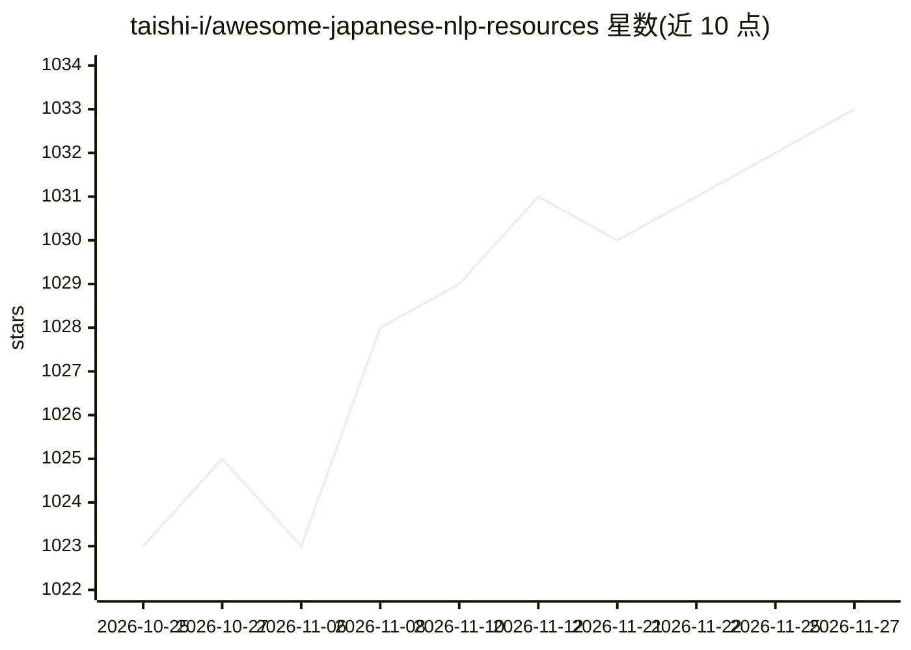

# taishi-i/awesome-japanese-nlp-resources

⭐ 1,033 · CC0-1.0 · 推送 2026-11-25 · [GitHub](https://github.com/taishi-i/awesome-japanese-nlp-resources) · [官网](https://awesome-japanese-nlp.org) · 个人维护

**日语 NLP 资源策展清单：902 个 GitHub 仓库与 513 个 Hugging Face 条目**

收录日语自然语言处理资源的 awesome 清单：按任务分类组织 902 个 GitHub 仓库与 513 个 Hugging Face 模型/数据集，覆盖形态分析、句法解析、字符转换、预处理、分句等类目，每类附下载量、星数与最近提交统计表。提供 Claude Code 与 Codex 插件，内置 1,450+ 条数据集，支持 search/discover/compare/research 四个技能，按查询语言自动切换回答语言。另有 awesome-japanese-nlp.org 网站按任务、热度与时效浏览。CC0 许可。

## 筛选速览

| 维度 | 判定 | 备注 |
|---|---|---|
| AI 角色 | `ai-knowledge` | 知识聚合/清单类 |
| 许可风险 | `viral` | CC0-1.0 |
| 部署形态 | `None` |  |
| 模型依赖 | — | README 未给出锁定关系 |
| 硬件要求 | — | 无带数字的原话,不猜 |
| 安装摩擦 | `low` | 无编译、无系统依赖或容器化 |
| 成熟度 | — | 结构信号不足 |

## 能力要点

- 收录 902 个 GitHub 仓库、513 个 Hugging Face 模型/数据集及 168 个多语言资源
- Claude Code/Codex 插件内置四个技能（search/discover/compare/research）
- 各类目附下载量、星数与最近提交统计表
- 多语言 README（英/日/繁中/简中）

## 适用场景

- 查找日语形态分析、句法解析等任务的 Python 库
- 通过 Claude Code 插件按用例检索推荐的日语 NLP 教程与库
- 为日语 NLP 项目寻找语料与数据集

## 场景标签

`精选清单` `编码 Agent` `教程课程` · 领域:编码与开发

## 证据(README 行号)

> L10: A curated list of resources dedicated to Python libraries, llms, dictionaries, and corpora of NLP for Japanese
> L33: Search, discover, and track Japanese NLP resources directly from Claude Code or Codex using the `awesome-japanese-n
> L84: ### Morphology analysis

## 星数曲线

2026-10-25 1,023 → 2026-11-27 1,033（+10）

---
*卡片 v1 · prompt 1.4 · 生成 2026-11-26 · 置信度 high · 依据 README sha `6d92cb7cae9e` · [字段定义](../../DATASET.md)*
