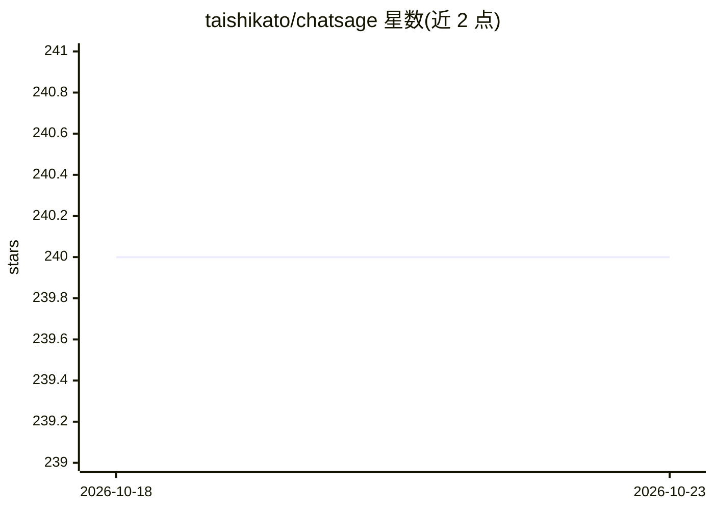

# taishikato/chatsage

⭐ 240 · TypeScript · Apache-2.0 · 推送 2025-12-14 · [GitHub](https://github.com/taishikato/chatsage) · [官网](https://chatsage.co) · 个人维护

**面向网站的开源 AI 客服聊天机器人，Chatbase 替代**

基于 Next.js、Supabase、Upstash、Tailwind CSS 与 ScrapingFish 构建的开源网站 AI 聊天机器人，README 自称 Chatbase 的开源替代，提供云版本（chatsage.co）与自托管两条路径。自托管需在 Supabase、Upstash、Vercel、ScrapingFish 各创建项目并配置 .env，通过 git clone 克隆、pnpm 安装依赖、supabase db push 应用数据库迁移，并启用 Supabase Google 登录。README 未展示模型推理与文档抓取细节。

## 筛选速览

| 维度 | 判定 | 备注 |
|---|---|---|
| AI 角色 | `ai-native` | 本体是模型或模型工具 |
| 许可风险 | `permissive` | Apache-2.0 |
| 部署形态 | `library` | 以包/库形式分发 |
| 模型依赖 | — | README 未给出锁定关系 |
| 硬件要求 | — | 无带数字的原话,不猜 |
| 安装摩擦 | `low` | 无编译、无系统依赖或容器化 |
| 成熟度 | — | 结构信号不足 |

## 能力要点

- 网站嵌入的 AI 聊天机器人，自称 Chatbase 开源替代
- 提供云版本与自托管两种使用方式
- 技术栈：Next.js/Supabase/Upstash/Tailwind CSS/ScrapingFish

## 适用场景

- 给自己的网站添加 24/7 客服聊天机器人
- 不想用 Chatbase 云服务时自行部署替代方案

## 场景标签

`聊天机器人` · 领域:对话与助手

## 证据(README 行号)

> L3:  The open-source AI Chatbot for your website
> L15: Chatsage is an open source Chatbase alternative.

## 星数曲线

2026-10-18 240 → 2026-10-23 240（+0）

---
*卡片 v1 · prompt 1.4 · 生成 2026-10-22 · 置信度 mid · 依据 README sha `0c1686b1c0c2` · [字段定义](../../DATASET.md)*
