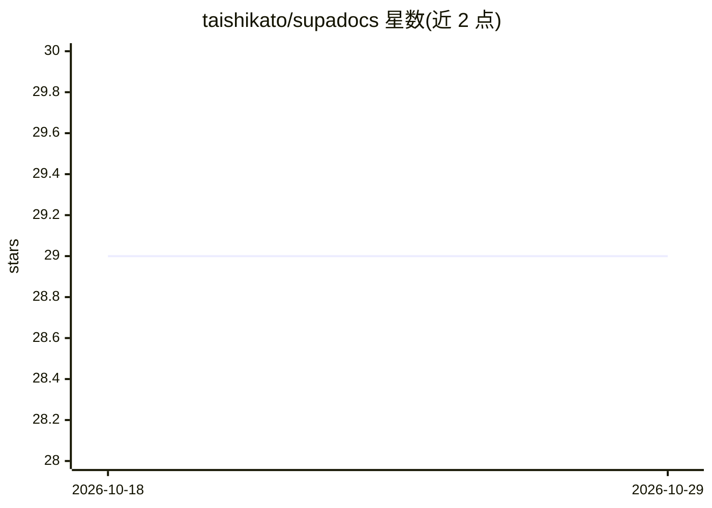

# taishikato/supadocs

⭐ 29 · TypeScript · 推送 2025-12-26 · [GitHub](https://github.com/taishikato/supadocs) · [官网](https://supadocs-ai.vercel.app) · 个人维护

**面向开发者的 AI 文档站模板：内置 RAG 搜索与聊天**

基于 Next.js、Supabase 与 OpenAI 的技术文档启动模板：用 Supabase + pgvector 存储文档分块与向量，OpenAI 生成嵌入与补全，GitHub Actions 在每次 PR 时把 Markdown 文档转为嵌入写入数据库，开箱即得 RAG 驱动的搜索与聊天界面，另附文章复制为 Markdown 与下载功能。部署需克隆仓库、关联 Supabase 项目、配置环境变量并运行 pnpm 安装启动。

## 筛选速览

| 维度 | 判定 | 备注 |
|---|---|---|
| AI 角色 | `ai-ecosystem` | LLM/agent 周边工具 |
| 许可风险 | `none` | — |
| 部署形态 | `library` | 以包/库形式分发 |
| 模型依赖 | — | README 未给出锁定关系 |
| 硬件要求 | — | 无带数字的原话,不猜 |
| 安装摩擦 | `low` | 无编译、无系统依赖或容器化 |
| 成熟度 | — | 结构信号不足 |

## 能力要点

- RAG 驱动的搜索与聊天体验，开箱即用
- Supabase + pgvector 存储分块与嵌入
- GitHub Actions 在 PR 时自动将文档转为嵌入入库
- 文章复制为 Markdown 与下载 Markdown 文件功能

## 适用场景

- 快速搭建带 AI 聊天能力的产品文档站
- 把自己的 Markdown 知识库接入 RAG 问答
- 基于模板二次开发文档平台

## 场景标签

`RAG` `聊天机器人` · 领域:对话与助手

## 证据(README 行号)

> L3: Supadocs is your AI-friendly docs starter built with Next.js, Supabase, and OpenAI.
> L6: - a built-in RAG-powered search and chat experience

## 星数曲线

2026-10-18 29 → 2026-10-29 29（+0）

---
*卡片 v1 · prompt 1.4 · 生成 2026-10-26 · 置信度 mid · 依据 README sha `a00083555da2` · [字段定义](../../DATASET.md)*
