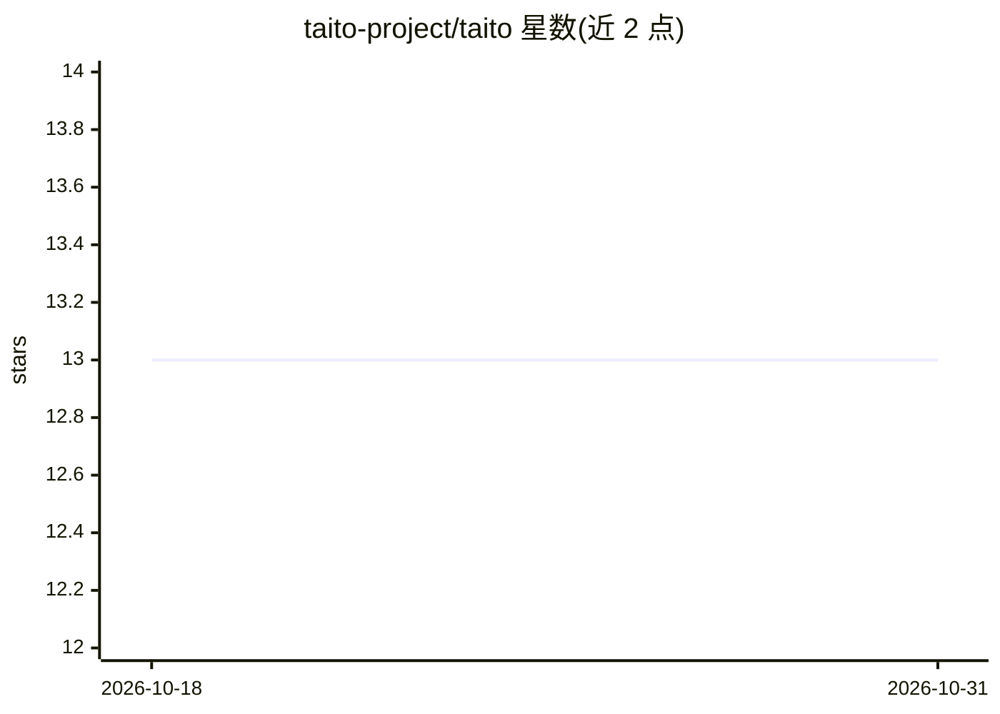

# taito-project/taito

⭐ 13 · Go · MIT · 推送 2026-06-10 · [GitHub](https://github.com/taito-project/taito) · [官网](https://taito-project.eu) · 组织维护

**AI 技能/Agent 的 OCI 制品包管理器，面向企业环境分发**

taito 是用 Go 编写的 AI skills/agents 打包与分发 CLI 工具：将多个技能及其依赖打包为 OCI 制品（bundles），支持从标准 OCI registry 与 GitHub 安装、list/update/uninstall 生命周期管理，并检测 registry 中 bundle 的更新。面向企业环境设计，强调对技能内容的清晰概览与组织内共享。通过 taito.spec（v0.1.0 规范）定义元数据，提供 init/package/push 命令完成自助打包发布；安装途径含安装脚本、go install、npm 与预编译二进制（deb/rpm/apk）。

## 筛选速览

| 维度 | 判定 | 备注 |
|---|---|---|
| AI 角色 | `ai-ecosystem` | LLM/agent 周边工具 |
| 许可风险 | `permissive` | MIT |
| 部署形态 | `library` | 以包/库形式分发 |
| 模型依赖 | — | README 未给出锁定关系 |
| 硬件要求 | — | 无带数字的原话,不猜 |
| 安装摩擦 | `low` | 无编译、无系统依赖或容器化 |
| 成熟度 | — | 结构信号不足 |

## 能力要点

- 将技能/Agent 及依赖打包为 OCI 制品（bundles）
- 基于标准 OCI registry 的安装/更新/卸载生命周期管理
- taito.spec v0.1.0 规范定义技能元数据，init 命令引导生成
- 支持从 GitHub 仓库交互式选择安装技能

## 适用场景

- 在企业内以 OCI registry 统一分发和管理 AI 技能包
- 把常用技能组合成 frontend/devops 等 bundle 一键安装
- 跟踪组织内技能 bundle 版本并自动更新

## 场景标签

 · 领域:AI 基础设施/技能分发

## 证据(README 行号)

> L12: `taito` is a packaging manager for AI skills/agents.
> L16: taito aims to be a standard way of packaging multiple skills and there dependencies into OCI artifacts, so called `
> L18: It was designed with corporate environments in mind, where there is a need for a clear overview of what is containe

## 星数曲线

2026-10-18 13 → 2026-10-31 13（+0）

---
*卡片 v1 · prompt 1.4 · 生成 2026-10-31 · 置信度 high · 依据 README sha `249f0417b5f3` · [字段定义](../../DATASET.md)*
