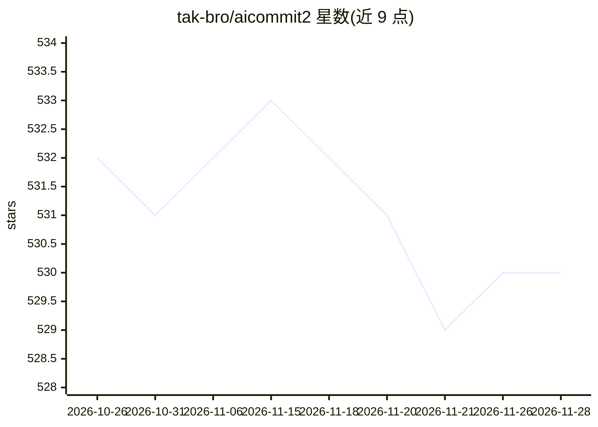

# tak-bro/aicommit2

⭐ 530 · TypeScript · MIT · 推送 2026-10-28 · [GitHub](https://github.com/tak-bro/aicommit2) · [官网](https://www.npmjs.com/package/aicommit2) · 个人维护

**用多家 AI 为 Git/Jujutsu 生成 commit 消息的 CLI**

命令行工具：读取 git diff（暂存变更），发送给用户配置的 AI 服务，返回生成的 commit 消息供用户选择后提交。支持 Git、YADM、Jujutsu 三种版本控制系统并自动检测仓库类型；可同时向多个 AI 发请求并挑选结果，支持 prepare-commit-msg hook、已有提交消息重写、提交前 AI 代码审查、自定义 prompt 模板与 diff 压缩（声称减少 30-60% token）。需至少配置一个 provider；Homebrew 安装不含 Copilot SDK 支持；diff 过大时可能报错，需减小提交单元。

## 筛选速览

| 维度 | 判定 | 备注 |
|---|---|---|
| AI 角色 | `ai-native` | 本体是模型或模型工具 |
| 许可风险 | `permissive` | MIT |
| 部署形态 | `library` | 以包/库形式分发 |
| 模型依赖 | local-ok | 支持本地模型 |
| 硬件要求 | — | 无带数字的原话,不猜 |
| 安装摩擦 | `low` | 无编译、无系统依赖或容器化 |
| 成熟度 | — | 结构信号不足 |

## 能力要点

- 同时请求多个 AI 并从结果中挑选 commit 消息
- 支持 Git/YADM/Jujutsu 仓库自动检测与 prepare-commit-msg hook
- OpenAI API 兼容：可接入任何实现该规范的服务
- 提交前 AI 代码审查（含严重级别）与 rewrite 子命令

## 适用场景

- 每次 git add 后自动生成规范的 commit 消息
- 在 dotfiles 管理工具 YADM 中生成提交说明
- 用 Jujutsu 工作流时自动生成提交描述
- 提交前让 AI 先做一次结构化代码审查

## 场景标签

`代码审查` `代码生成` · 领域:编码与开发

## 证据(README 行号)

> L26: _aicommit2_ automatically generates commit messages using AI. It supports Git, YADM (Yet Another Dotfiles Manager),
> L31: - **Multi-AI Support**: Integrates with OpenAI, Anthropic Claude, Google Gemini, Mistral AI, Cohere, Groq, Ollama a
> L184: This CLI tool runs `git diff` to grab all your latest code changes, sends them to configured AI, then returns the 

## 星数曲线

2026-10-26 532 → 2026-11-28 530（-2）

---
*卡片 v1 · prompt 1.4 · 生成 2026-11-25 · 置信度 high · 依据 README sha `82aeb0c1ae9e` · [字段定义](../../DATASET.md)*
