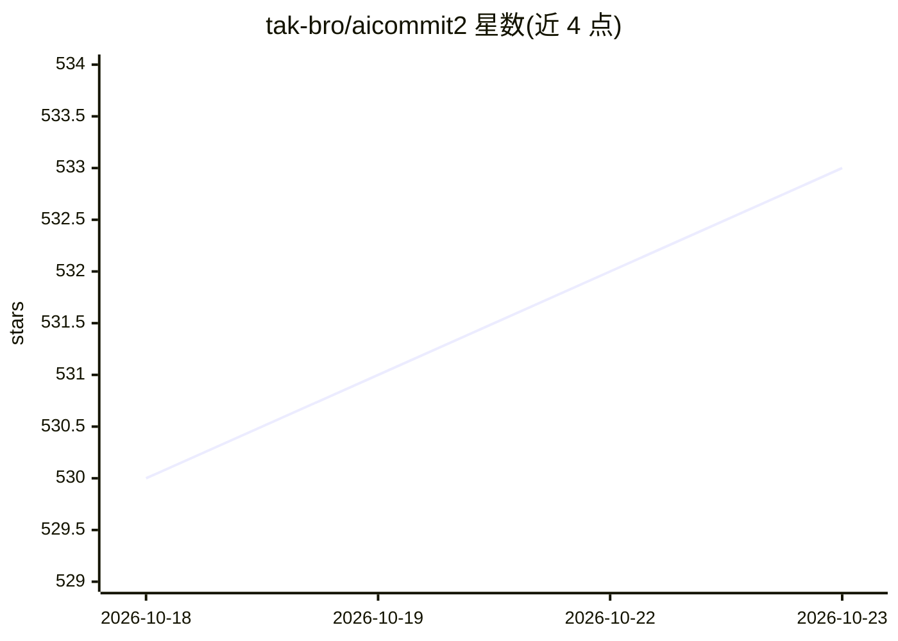

# tak-bro/aicommit2

⭐ 533 · TypeScript · MIT · 推送 2026-10-22 · [GitHub](https://github.com/tak-bro/aicommit2) · [官网](https://www.npmjs.com/package/aicommit2) · 个人维护

**CLI 工具：用多种 AI 生成 Git/YADM/Jujutsu 提交信息**

面向使用 Git、YADM、Jujutsu 的开发者的命令行工具：运行 git diff 读取暂存变更，发送到已配置的 AI 提供商，生成交互式可挑选的提交信息，并可直接完成提交。支持 OpenAI、Anthropic、Gemini、Ollama、Groq 等十余种提供商及任意 OpenAI 兼容 API，可同时向多个 AI 请求并选择结果。附加功能包括提交前结构化代码审查、重写已有提交信息、Git hook 集成与 diff 压缩以减少 token 用量。限制：diff 过大时 AI 无法正常工作；Homebrew 安装不含 Copilot SDK 支持。

## 筛选速览

| 维度 | 判定 | 备注 |
|---|---|---|
| AI 角色 | `ai-native` | 本体是模型或模型工具 |
| 许可风险 | `permissive` | MIT |
| 部署形态 | `library` | 以包/库形式分发 |
| 模型依赖 | local-ok | 支持本地模型 |
| 硬件要求 | — | 无带数字的原话,不猜 |
| 安装摩擦 | `low` | 无编译、无系统依赖或容器化 |
| 成熟度 | — | 结构信号不足 |

## 能力要点

- 支持 Git、YADM、Jujutsu 三种版本控制系统并自动检测
- 集成十余家 AI 提供商及任意 OpenAI 兼容 API
- 可同时向多个 AI 发起请求并挑选提交信息
- 提供结构化代码审查、提交重写、自定义提示词与 diff 压缩

## 适用场景

- 在提交前自动生成符合 conventional/gitmoji 格式的提交信息
- 同时请求多个模型并挑选最合适的提交信息
- 在 dotfiles（YADM）或 Jujutsu 仓库中生成提交信息

## 场景标签

`代码生成` `代码审查` · 领域:编码与开发

## 证据(README 行号)

> L26: _aicommit2_ automatically generates commit messages using AI. It supports Git, YADM (Yet Another Dotfiles Manager),
> L184: This CLI tool runs `git diff` to grab all your latest code changes, sends them to configured AI, then returns the 

## 星数曲线

2026-10-18 530 → 2026-10-23 533（+3）

---
*卡片 v1 · prompt 1.4 · 生成 2026-10-21 · 置信度 high · 依据 README sha `213d5bc99898` · [字段定义](../../DATASET.md)*
