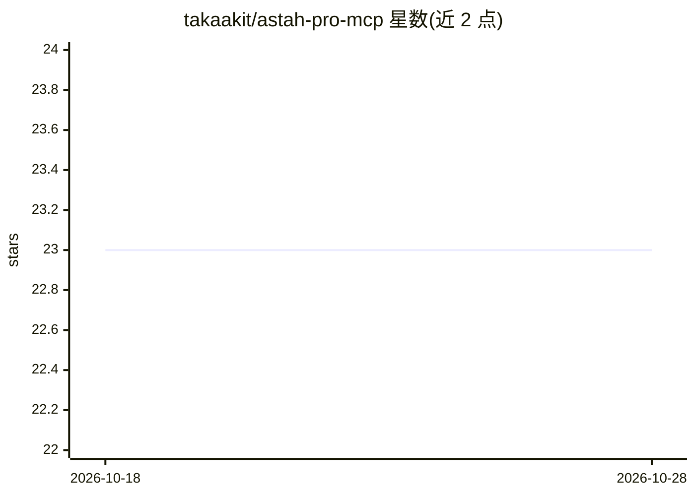

# takaakit/astah-pro-mcp

⭐ 23 · Java · 推送 2026-10-22 · [GitHub](https://github.com/takaakit/astah-pro-mcp) · 个人维护

**Astah Professional 的 MCP 服务器插件：让 AI agent 操作 UML 模型**

以 Astah Professional 插件形式运行的本地 MCP 服务器，使 AI agent（Claude Code、Codex CLI、Grok Build、Cursor 等）能够设计系统并生成 UML 模型、解释模型、在 UML 与源码间互相生成、从手绘草图创建图。支持 10 种图类型（部分仅查询）。提供程序化工具调用模式（端口 8888，85 个工具）与直接调用模式（端口 18888，392 个工具）。限制：项目处于实验阶段可能引入破坏性变更；模型数据会共享给 AI agent 存在保密风险；未实现 token 节省措施；须持有 Astah 有效许可且仅限本机自用。

## 筛选速览

| 维度 | 判定 | 备注 |
|---|---|---|
| AI 角色 | `ai-ecosystem` | LLM/agent 周边工具 |
| 许可风险 | `none` | — |
| 部署形态 | `None` |  |
| 模型依赖 | — | README 未给出锁定关系 |
| 硬件要求 | — | 无带数字的原话,不猜 |
| 安装摩擦 | `low` | 无编译、无系统依赖或容器化 |
| 成熟度 | `idea` | |

## 能力要点

- AI agent 可创建/解释 UML 模型并在 UML 与源码间互相生成
- 两种工具调用模式：程序化（85 个工具）与直接（392 个工具）
- 支持 10 种图类型，含类图、序列图、状态机图等
- 从手绘草图创建 UML 图

## 适用场景

- 让 Claude Code 等 agent 按自然语言描述在 Astah 中画出系统设计图
- 基于已有 Astah 模型生成序列图/活动图说明系统行为
- 从 UML 模型生成源代码或反向生成模型

## 场景标签

 · 领域:软件开发/UML 建模工具

## 证据(README 行号)

> L3: A local MCP server plugin for Astah Professional, a UML modeling tool, that enables AI agents to:
> L10: This plugin experimentally implements a programmatic tool calling mode, inspired by the **"Programmatic Tool Callin

## 星数曲线

2026-10-18 23 → 2026-10-28 23（+0）

---
*卡片 v1 · prompt 1.4 · 生成 2026-10-27 · 置信度 high · 依据 README sha `41256cf16b62` · [字段定义](../../DATASET.md)*
