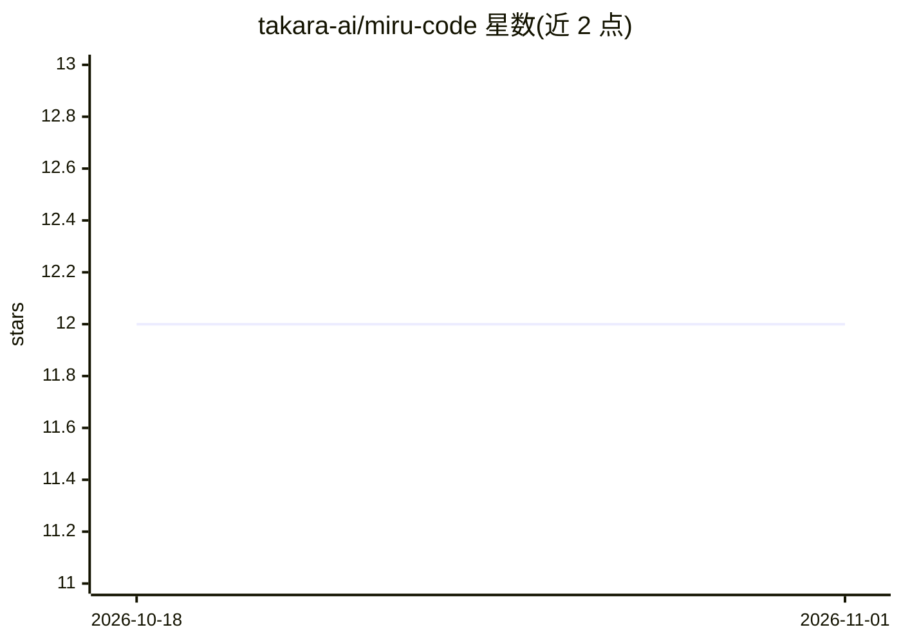

# takara-ai/miru-code

⭐ 12 · TypeScript · MIT · 推送 2026-10-27 · [GitHub](https://github.com/takara-ai/miru-code) · [官网](https://takara.ai/miru) · 组织维护

**面向 AI 编程代理的混合代码搜索工具（MCP）**

Miru 是供 AI 编程代理使用的混合代码搜索服务：通过 MCP 提供 search/locate/expand/find_related 等工具，返回相关文件路径、行号与源码摘录。检索机制为 embeddings + BM25 + 代码感知排序，Tree-sitter 提供 26 种语言的语法感知分块。默认将文件内容与查询经 HTTPS 发送到 Takara 做嵌入（API 可能产生费用），也可用 AWS SageMaker 自托管嵌入端点。提供托管端点或自托管两种方式，需 Bun 1.1+ 运行。

## 筛选速览

| 维度 | 判定 | 备注 |
|---|---|---|
| AI 角色 | `ai-ecosystem` | LLM/agent 周边工具 |
| 许可风险 | `permissive` | MIT |
| 部署形态 | `None` |  |
| 模型依赖 | locked-api |  |
| 硬件要求 | — | 无带数字的原话,不猜 |
| 安装摩擦 | `low` | 无编译、无系统依赖或容器化 |
| 成熟度 | — | 结构信号不足 |

## 能力要点

- 通过 MCP 提供 search/locate/expand/find_related 等代码搜索工具
- embeddings + BM25 + 代码感知混合排序，Tree-sitter 支持 26 种语言分块
- 可接入 Claude Code、Codex、Cursor 等代理，提供插件与 CLI 安装两种途径
- 支持自托管嵌入端点（AWS SageMaker），可限制 MCP 访问目录

## 适用场景

- 让 Claude Code/Cursor 等编程代理用更少步骤定位代码位置
- 在终端按语义、精确字符串或正则搜索代码库
- 对嵌入数据不出自有基础设施的团队，用 SageMaker 自托管端点

## 场景标签

`语义搜索` · 领域:知识与检索

## 证据(README 行号)

> L5: **Hybrid code search for AI coding agents.**
> L7: Ask where something happens in your codebase. Miru returns relevant file paths, line numbers, and source excerpts th
> L61: |Tool|Purpose|

## 星数曲线

2026-10-18 12 → 2026-11-01 12（+0）

---
*卡片 v1 · prompt 1.4 · 生成 2026-10-31 · 置信度 high · 依据 README sha `4d3732bb2147` · [字段定义](../../DATASET.md)*
