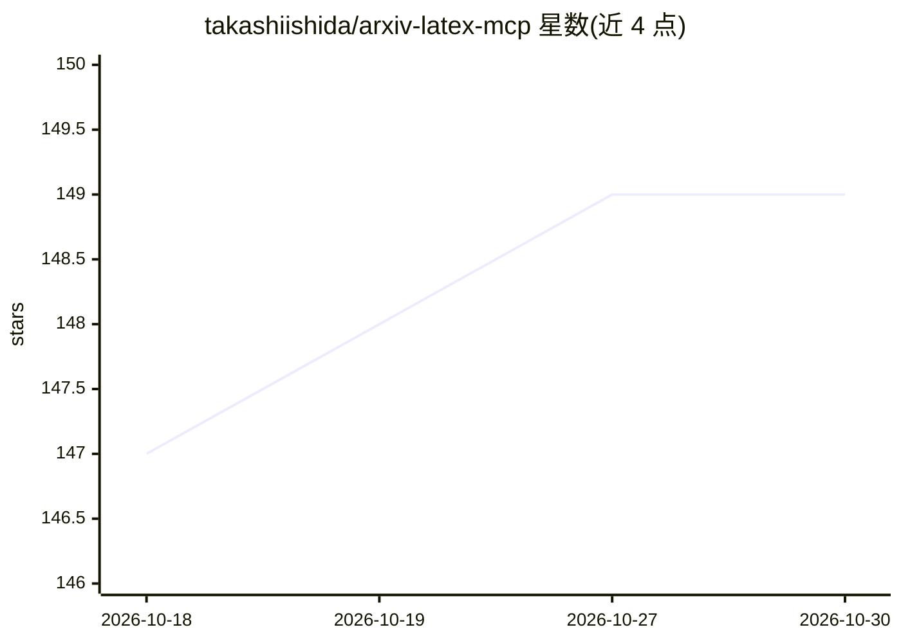

# takashiishida/arxiv-latex-mcp

⭐ 149 · Python · MIT · 推送 2026-10-23 · [GitHub](https://github.com/takashiishida/arxiv-latex-mcp) · 个人维护

**为 MCP 客户端提供 arXiv 论文 LaTeX 源获取与处理服务**

一个 MCP server，使 Claude Desktop、Claude Code、Cursor 等 MCP 客户端能够直接获取并处理 arXiv 论文的 LaTeX 源码。底层使用 arxiv-to-prompt 完成下载与处理，将 LaTeX 源码拍平后提供给 LLM，以准确理解数学公式与符号密集的论文。提供 get_paper_prompt、get_paper_abstract、list_paper_sections、get_paper_section 四个工具。安装方式包括 .mcpb 桌面扩展双击安装、uvx 直接运行、pip 安装及本地检出运行。

## 筛选速览

| 维度 | 判定 | 备注 |
|---|---|---|
| AI 角色 | `ai-ecosystem` | LLM/agent 周边工具 |
| 许可风险 | `permissive` | MIT |
| 部署形态 | `library` | 以包/库形式分发 |
| 模型依赖 | locked-api |  |
| 硬件要求 | — | 无带数字的原话,不猜 |
| 安装摩擦 | `low` | 无编译、无系统依赖或容器化 |
| 成熟度 | — | 结构信号不足 |

## 能力要点

- 获取 arXiv 论文原始 LaTeX 源码而非 PDF，保留数学表达式
- 提供 4 个 MCP 工具：全文拍平 LaTeX、摘要、章节列表、按路径取章节
- 支持 .mcpb 桌面扩展、uvx、pip 三种安装运行方式
- 支持 macOS、Windows、Linux

## 适用场景

- 让 Claude Desktop/Cursor 直接阅读 arXiv 论文并解答公式推导
- 向 AI 提问论文中某个定理或章节的解释
- 处理数学/工程类公式密集论文，避免 PDF 解析失真

## 场景标签

`科研工具` `文档解析` · 领域:知识与检索

## 证据(README 行号)

> L7: An MCP server that enables Claude Desktop, Claude Code, Cursor, or other MCP clients to directly access and process 
> L43: - `get_paper_prompt` — Get the full flattened LaTeX of a paper

## 星数曲线

2026-10-18 147 → 2026-10-30 149（+2）

---
*卡片 v1 · prompt 1.4 · 生成 2026-10-23 · 置信度 high · 依据 README sha `8c2793e4188c` · [字段定义](../../DATASET.md)*
