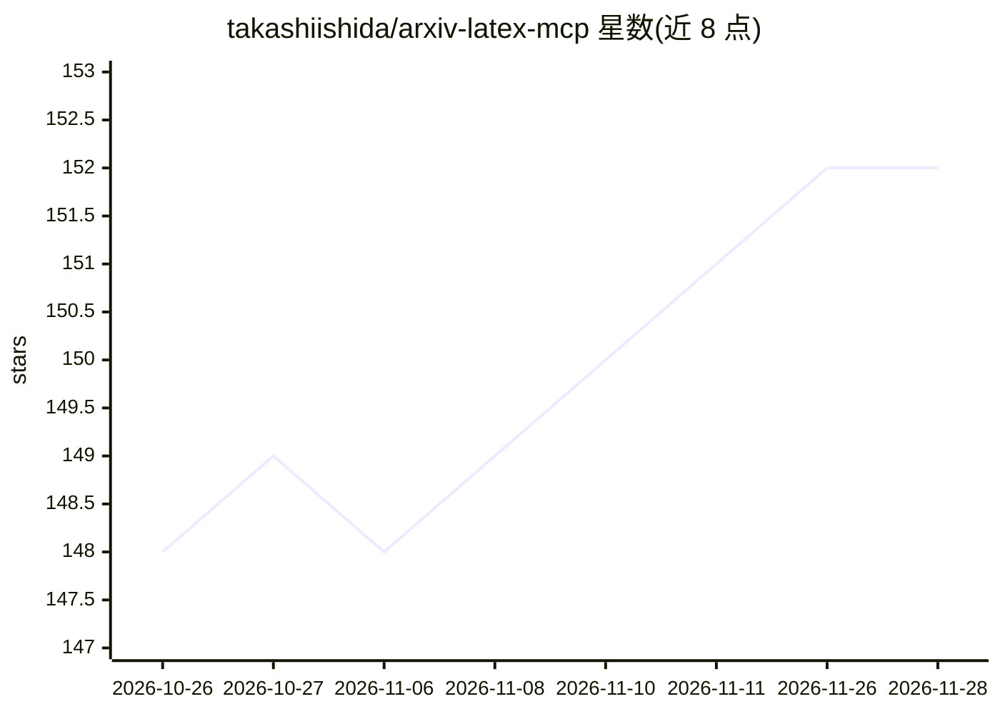

# takashiishida/arxiv-latex-mcp

⭐ 152 · Python · MIT · 推送 2026-11-22 · [GitHub](https://github.com/takashiishida/arxiv-latex-mcp) · 个人维护

**让 MCP 客户端读取 arXiv 论文 LaTeX 源码的 MCP server**

基于 arxiv-to-prompt 的 MCP 服务器，使 Claude Desktop、Claude Code、Cursor 等 MCP 客户端能获取并处理 arXiv 论文的 LaTeX 源码，让 LLM 准确理解公式与数学符号；提供 5 个工具（获取全文 LaTeX、摘要、章节列表、指定章节、按主题/标题/作者检索论文），带缓存机制（默认缓存、未版本化 ID 超 7 天重下载）与三秒检索节流。安装支持 .mcpb 桌面扩展、uvx、pip 及本地源码运行，需 Python 3.11+。

## 筛选速览

| 维度 | 判定 | 备注 |
|---|---|---|
| AI 角色 | `ai-ecosystem` | LLM/agent 周边工具 |
| 许可风险 | `permissive` | MIT |
| 部署形态 | `library` | 以包/库形式分发 |
| 模型依赖 | — | README 未给出锁定关系 |
| 硬件要求 | — | 无带数字的原话,不猜 |
| 安装摩擦 | `low` | 无编译、无系统依赖或容器化 |
| 成熟度 | — | 结构信号不足 |

## 能力要点

- 5 个 MCP 工具：全文 LaTeX、摘要、章节列表、章节读取、论文检索
- LaTeX 源码方式处理公式密集论文（借助 arxiv-to-prompt）
- 缓存机制可配置（开关、TTL、目录），检索有三秒节流
- 支持 .mcpb 桌面扩展一键安装，跨 macOS/Windows/Linux

## 适用场景

- 在 Claude Desktop 中对话式解读 arXiv 论文的定理与公式
- 数学、计算机、工程领域的论文问答
- 按主题/类别/日期检索相关论文后直接阅读 LaTeX 源码

## 场景标签

`科研工具` · 领域:学习与行业

## 证据(README 行号)

> L7: An MCP server that enables Claude Desktop, Claude Code, Cursor, or other MCP clients to directly access and process 
> L44: - `get_paper_prompt` — Get the full flattened LaTeX of a paper

## 星数曲线

2026-10-26 148 → 2026-11-28 152（+4）

---
*卡片 v1 · prompt 1.4 · 生成 2026-11-27 · 置信度 high · 依据 README sha `9a398cec87c2` · [字段定义](../../DATASET.md)*
