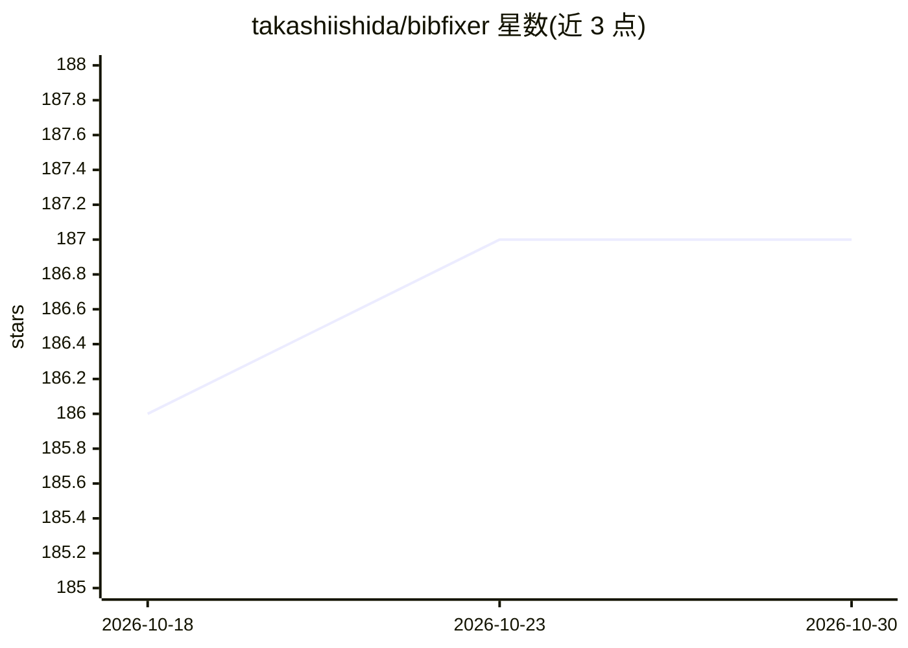

# takashiishida/bibfixer

⭐ 187 · Python · MIT · 推送 2026-06-10 · [GitHub](https://github.com/takashiishida/bibfixer) · 个人维护

**用 LLM+网络搜索自动清洗补全 BibTeX 条目的 Python 工具**

命令行 Python 工具，读取 .bib 文件后借助 LLM 与网络搜索（OpenAI 默认，OpenRouter 可选，经 Exa.ai :online 后缀联网）补全缺失作者、修正标题大小写、把 arXiv 版本替换为正式会议/出版社信息，并按用户偏好统一风格（venue 命名、页码范围等）。修改指令由可编辑的 prompts/default.md 提供，可用 -p 传附加偏好或 --prompt-file 指定自定义提示。README 声明为实验性，可能产生错误元数据，建议提交前用 diff 核对。面向写 LaTeX 论文的研究者。

## 筛选速览

| 维度 | 判定 | 备注 |
|---|---|---|
| AI 角色 | `ai-native` | 本体是模型或模型工具 |
| 许可风险 | `permissive` | MIT |
| 部署形态 | `library` | 以包/库形式分发 |
| 模型依赖 | — | README 未给出锁定关系 |
| 硬件要求 | — | 无带数字的原话,不猜 |
| 安装摩擦 | `low` | 无编译、无系统依赖或容器化 |
| 成熟度 | `idea` | |

## 能力要点

- LLM+网络搜索补全缺失作者与元数据，将 arXiv 条目替换为正式发表信息
- 按用户偏好统一格式（venue 命名、标题大小写、作者格式、页码范围）
- 默认 OpenAI，可选 OpenRouter 指定其他模型
- 提供 Streamlit 应用界面与可自定义的 prompt 文件

## 适用场景

- 投稿前批量清洗从 Google Scholar 复制的 BibTeX 条目
- 补全缺失作者、把 arXiv 预印本条目更新为正式会议/出版社信息
- 按期刊/会议要求统一参考文献格式风格

## 场景标签

`科研工具` · 领域:学习与行业

## 证据(README 行号)

> L7: A Python tool that fixes and standardizes your BibTeX. It not only completes entries with accurate metadata via LLM 
> L79: # For OpenAI (default provider):

## 星数曲线

2026-10-18 186 → 2026-10-30 187（+1）

---
*卡片 v1 · prompt 1.4 · 生成 2026-10-23 · 置信度 high · 依据 README sha `fbc6be22865b` · [字段定义](../../DATASET.md)*
