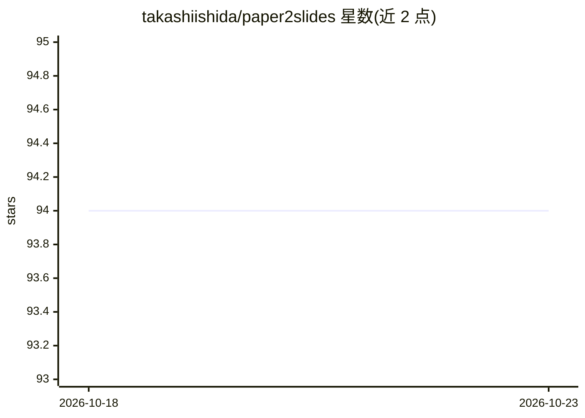

# takashiishida/paper2slides

⭐ 94 · Python · MIT · 推送 2026-03-17 · [GitHub](https://github.com/takashiishida/paper2slides) · 个人维护

**用 LLM 将 arXiv 论文自动转成 Beamer 幻灯片 PDF**

命令行与 Streamlit Web UI 工具：下载 arXiv 论文 LaTeX 源码，经 arxiv-to-prompt 展平与预处理后，调用 OpenAI API 将长文转为 Beamer LaTeX 并用 pdflatex 编译为 PDF 幻灯片。关键机制包括：ADDITIONAL.tex 汇总宏定义以增强生成可靠性、LLM 自检修订、可选 chktex linter 反馈修正；提示词由 YAML 配置管理，图内容从题注推断而无需视觉能力。需 Python 3.10+、pdflatex 与 OpenAI API key；GPT-4.1 下单篇通常数分钟内完成。限制：会将论文内容发送至 OpenAI API，并需遵守 arXiv 各论文许可。

## 筛选速览

| 维度 | 判定 | 备注 |
|---|---|---|
| AI 角色 | `ai-native` | 本体是模型或模型工具 |
| 许可风险 | `permissive` | MIT |
| 部署形态 | `library` | 以包/库形式分发 |
| 模型依赖 | — | README 未给出锁定关系 |
| 硬件要求 | — | 无带数字的原话,不猜 |
| 安装摩擦 | `low` | 无编译、无系统依赖或容器化 |
| 成熟度 | — | 结构信号不足 |

## 能力要点

- arXiv LaTeX 源码→Beamer 幻灯片→PDF 全流程自动化
- ADDITIONAL.tex 汇总宏定义、LLM 自检与可选 linter 反馈修正
- YAML 配置管理提示词模板与阶段（initial/update/revise）
- 提供 CLI 与 Streamlit 点选式 Web UI，支持交互式编辑后自动重编译

## 适用场景

- 快速把握研究论文主要思想的幻灯片
- 将 arXiv 论文转成可编辑的 Beamer LaTeX 演示文稿
- 通过搜索关键词找论文并生成幻灯片

## 场景标签

`科研工具` · 领域:学习与行业

## 证据(README 行号)

> L5: Transform any arXiv papers into slides using LLMs! This tool is useful for quickly grasping the main ideas of resear
> L58: - `tex2beamer.py` downloads and processes the arXiv paper using `arxiv-to-prompt`, then generates Beamer slides via

## 星数曲线

2026-10-18 94 → 2026-10-23 94（+0）

---
*卡片 v1 · prompt 1.4 · 生成 2026-10-23 · 置信度 mid · 依据 README sha `a579b0c9da05` · [字段定义](../../DATASET.md)*
