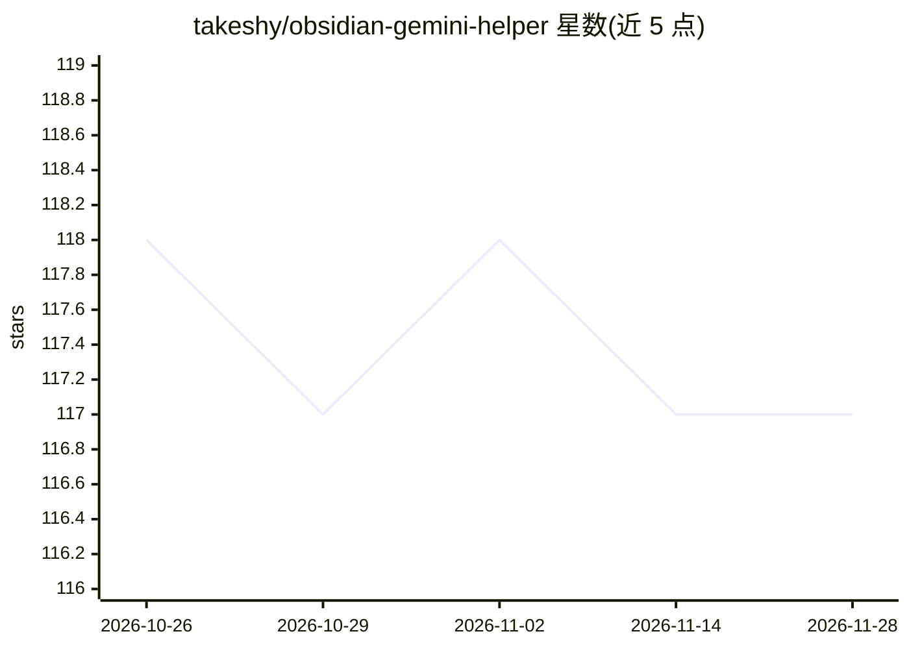

# takeshy/obsidian-gemini-helper

⭐ 117 · TypeScript · MIT · 推送 2026-11-21 · [GitHub](https://github.com/takeshy/obsidian-gemini-helper) · 个人维护

**Obsidian 插件：接入 Gemini 的聊天、工作流自动化与知识库 RAG**

面向 Obsidian 用户的免费开源 AI 助手插件，基于 Google Gemini API key 运行，支持桌面端与移动端。功能包括流式 AI 聊天（文件附件、@ 引用笔记/PDF、斜杠命令模板）、24 种节点的可视化工作流构建器、跨 vault 语义检索（RAG）、OKF 知识源加载，以及通过 function calling 执行读写笔记、搜索、重命名等 vault 操作。提供聊天历史与工作流日志加密、AI 修改的 diff 追踪还原、API 用量与成本统计，并可与 MCP 工具、Dashboard Hub、Discussion Hub 插件集成。

## 筛选速览

| 维度 | 判定 | 备注 |
|---|---|---|
| AI 角色 | `ai-native` | 本体是模型或模型工具 |
| 许可风险 | `permissive` | MIT |
| 部署形态 | `library` | 以包/库形式分发 |
| 模型依赖 | — | README 未给出锁定关系 |
| 硬件要求 | — | 无带数字的原话,不猜 |
| 安装摩擦 | `low` | 无编译、无系统依赖或容器化 |
| 成熟度 | — | 结构信号不足 |

## 能力要点

- AI 聊天支持流式输出、文件附件、@ 引用与斜杠命令模板
- 可视化节点编辑器的工作流自动化（24 种节点类型）
- vault 级 RAG 语义检索与 OKF 知识源按需加载
- function calling 提供 14+ 种 vault 操作工具，支持权限分级与加密、diff 追踪

## 适用场景

- 在 Obsidian 笔记库中直接与 Gemini 对话并让它代为整理笔记
- 用可视化工作流自动化多步骤笔记处理任务
- 对整个 vault 做语义检索找回笔记内容
- 通过语音与 Gemini 实时对话并将转录保存进聊天记录

## 场景标签

`AI 助手` `知识库管理` `RAG` `工作流自动化` · 领域:效率与自动化

## 证据(README 行号)

> L5: **Free and open-source** AI assistant for Obsidian with **Chat**, **Workflow Automation**, and **RAG** powered by Go
> L17: - **RAG** - Retrieval-Augmented Generation for intelligent search across your vault
> L49: The AI Chat feature provides an interactive conversation interface with Google Gemini, integrated with your Obsidia

## 星数曲线

2026-10-26 118 → 2026-11-28 117（-1）

---
*卡片 v1 · prompt 1.4 · 生成 2026-11-28 · 置信度 mid · 依据 README sha `c55a613870fe` · [字段定义](../../DATASET.md)*
