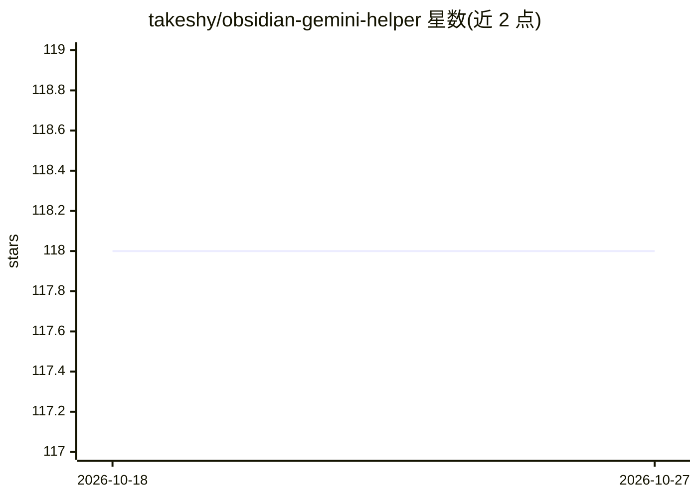

# takeshy/obsidian-gemini-helper

⭐ 118 · TypeScript · MIT · 推送 2026-10-26 · [GitHub](https://github.com/takeshy/obsidian-gemini-helper) · 个人维护

**Obsidian 的 Gemini AI 助手插件：对话、工作流与 RAG**

面向 Obsidian 用户的免费开源插件，以 Google Gemini 为后端提供流式 AI 对话（支持文件附件、斜杠命令、@ 提及、语音输入与朗读）、可视化节点式工作流自动化（24 种节点类型、MCP 工具支持）、基于 Google File Search 的库内 RAG 语义检索（支持 Markdown/PDF/Office 文档）、OKF 知识包与 Agent 技能扩展。AI 可通过函数调用读写笔记库（编辑/删除需确认、带 diff 历史与加密），并可限制可访问文件夹。需自备 Gemini API key，免费 key 下 RAG 受限、无图像生成，桌面与移动端均可用。

## 筛选速览

| 维度 | 判定 | 备注 |
|---|---|---|
| AI 角色 | `ai-native` | 本体是模型或模型工具 |
| 许可风险 | `permissive` | MIT |
| 部署形态 | `library` | 以包/库形式分发 |
| 模型依赖 | — | README 未给出锁定关系 |
| 硬件要求 | — | 无带数字的原话,不猜 |
| 安装摩擦 | `low` | 无编译、无系统依赖或容器化 |
| 成熟度 | — | 结构信号不足 |

## 能力要点

- 流式 AI 对话，支持附件（图片/PDF/音视频）、斜杠命令与语音对话
- 可视化节点编辑器的工作流自动化（24 种节点类型，支持 MCP 工具）
- 基于 Google File Search 的 RAG 库内检索，支持增量同步
- AI 笔记操作带确认对话框、diff 编辑历史与聊天记录加密

## 适用场景

- 在 Obsidian 内与 Gemini 对话并让其读写笔记库
- 用可视化工作流自动化多步骤笔记任务
- 对整个笔记库做语义搜索（RAG）

## 场景标签

`RAG` `工作流自动化` `聊天机器人` · 领域:效率与自动化

## 证据(README 行号)

> L5: **Free and open-source** AI assistant for Obsidian with **Chat**, **Workflow Automation**, and **RAG** powered by Go
> L49: The AI Chat feature provides an interactive conversation interface with Google Gemini, integrated with your Obsidia

## 星数曲线

2026-10-18 118 → 2026-10-27 118（+0）

---
*卡片 v1 · prompt 1.4 · 生成 2026-10-23 · 置信度 mid · 依据 README sha `1f536d7e6980` · [字段定义](../../DATASET.md)*
