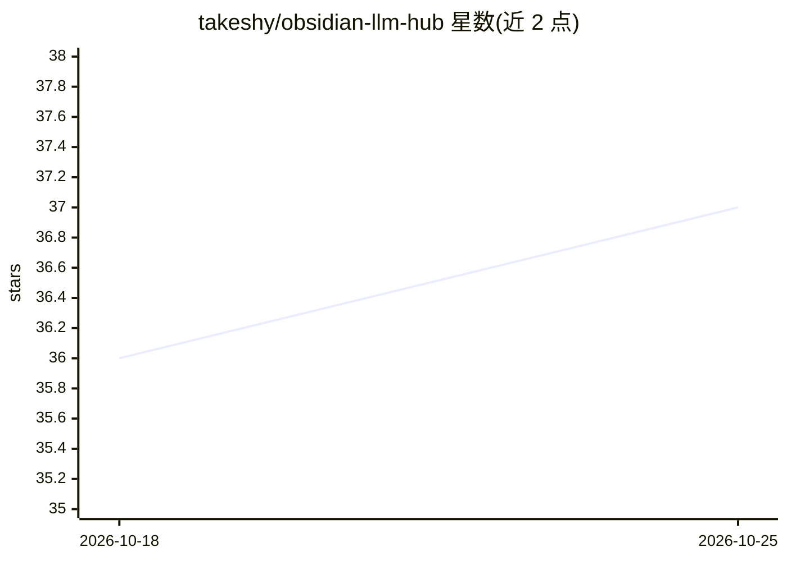

# takeshy/obsidian-llm-hub

⭐ 37 · TypeScript · MIT · 推送 2026-10-12 · [GitHub](https://github.com/takeshy/obsidian-llm-hub) · 个人维护

**Obsidian 多模型 AI 助手插件：聊天、工作流与语义搜索**

开源 Obsidian 插件，为笔记用户接入多家 LLM（Gemini、OpenAI、Anthropic、OpenRouter、Grok、OpenCode Zen/Go、本地 Ollama/LM Studio/vLLM 及 Claude Code 等 CLI 后端），提供 AI 聊天、可视化节点工作流自动化（25 种节点）、本地向量语义搜索（RAG）、AI 读写笔记库（函数调用）、带引用的 Web 搜索与图像生成。限制：Ollama 与 CLI 后端不支持 vault 工具（走 marker 模式），Web 搜索仅限官方 API 端点。

## 筛选速览

| 维度 | 判定 | 备注 |
|---|---|---|
| AI 角色 | `ai-native` | 本体是模型或模型工具 |
| 许可风险 | `permissive` | MIT |
| 部署形态 | `desktop` | 安装包/桌面程序 |
| 模型依赖 | local-ok | 支持本地模型 |
| 硬件要求 | — | 无带数字的原话,不猜 |
| 安装摩擦 | `low` | 无编译、无系统依赖或容器化 |
| 成熟度 | — | 结构信号不足 |

## 能力要点

- 多 provider 同时配置，聊天中自由切换模型
- AI 通过函数调用读取、写入、搜索与编辑笔记
- 可视化工作流构建器（25 种节点类型）
- 本地向量语义搜索（RAG）与带引用的 Web 搜索

## 适用场景

- 在 Obsidian 内与多家模型对话并让 AI 直接编辑笔记
- 用可视化工作流自动化多步笔记处理任务
- 对自己的笔记库做本地语义搜索

## 场景标签

`AI 助手` `工作流自动化` `RAG` `图像生成` · 领域:效率与自动化

## 证据(README 行号)

> L5: **Free and open-source** AI assistant for Obsidian with **Chat**, **Workflow Automation**, and **Semantic Search (RA
> L7: > **Use any LLM provider:** Gemini, OpenAI, Anthropic, OpenRouter, Grok, OpenCode Zen / Go, local LLMs (Ollama, LM S

## 星数曲线

2026-10-18 36 → 2026-10-25 37（+1）

---
*卡片 v1 · prompt 1.4 · 生成 2026-10-25 · 置信度 mid · 依据 README sha `a404137a4ee6` · [字段定义](../../DATASET.md)*
