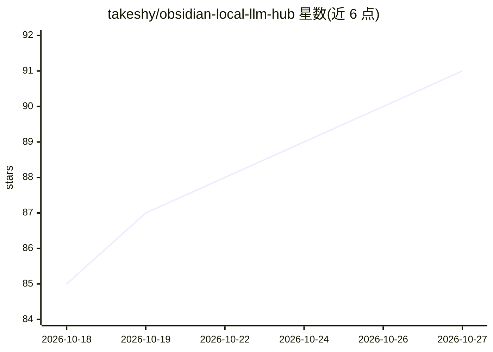

# takeshy/obsidian-local-llm-hub

⭐ 91 · TypeScript · MIT · 推送 2026-10-26 · [GitHub](https://github.com/takeshy/obsidian-local-llm-hub) · 个人维护

**Obsidian 全本地 AI 枢纽：LLM 对话、RAG、工作流自动化与 MCP 集成**

面向 Obsidian 用户的本地 AI 插件：通过 localhost 连接 Ollama、LM Studio、vLLM 或 AnythingLLM 提供流式聊天、语音输入与朗读；用本地嵌入模型（如 nomic-embed-text）索引笔记与 PDF 实现 RAG 及语义搜索；核心的工作流引擎支持自然语言生成/修改工作流与技能（23 种节点、事件触发、热键），并通过函数调用让模型直接操作 vault（13 个工具），可挂载本地 stdio MCP 服务器与 SKILL.md 技能。聊天记录存为 vault 内 Markdown，编辑历史为内存态、重启即清空。

## 筛选速览

| 维度 | 判定 | 备注 |
|---|---|---|
| AI 角色 | `ai-native` | 本体是模型或模型工具 |
| 许可风险 | `permissive` | MIT |
| 部署形态 | `desktop` | 安装包/桌面程序 |
| 模型依赖 | local-ok | 支持本地模型 |
| 硬件要求 | — | 无带数字的原话,不猜 |
| 安装摩擦 | `low` | 无编译、无系统依赖或容器化 |
| 成熟度 | — | 结构信号不足 |

## 能力要点

- 自然语言创建/修改工作流与技能，含计划-生成-审查流程与 YAML 解析重试
- 23 种节点、12 类的可视化节点编辑器，支持事件触发与热键
- 本地嵌入模型对 vault（含 PDF）建 RAG 索引，支持关键词过滤与 AI 精炼的语义搜索
- 函数调用直接操作 vault（13 个工具、三种权限模式），MCP 服务器以本地子进程运行

## 适用场景

- 在公司禁止云端 API 的环境下用本地模型做笔记问答与自动化
- 让 AI 直接读取、创建、编辑 vault 笔记并执行工作流
- 对笔记库建本地 RAG 索引做语义搜索

## 场景标签

`工作流自动化` `知识库管理` `RAG` `语义搜索` · 领域:效率与自动化

## 证据(README 行号)

> L5: Local LLM Hub brings the full power of Gemini Helper's workflow automation, RAG, MCP integration, and agent skills t
> L115: Streaming chat with your local LLM. Thinking display, file attachments, `@` mentions for vault notes, multiple ses
> L141: Models with function calling support (Qwen, Llama 3.1+, Mistral) can directly interact with your vault:

## 星数曲线

2026-10-18 85 → 2026-10-27 91（+6）

---
*卡片 v1 · prompt 1.4 · 生成 2026-10-23 · 置信度 high · 依据 README sha `b156ca8a3048` · [字段定义](../../DATASET.md)*
