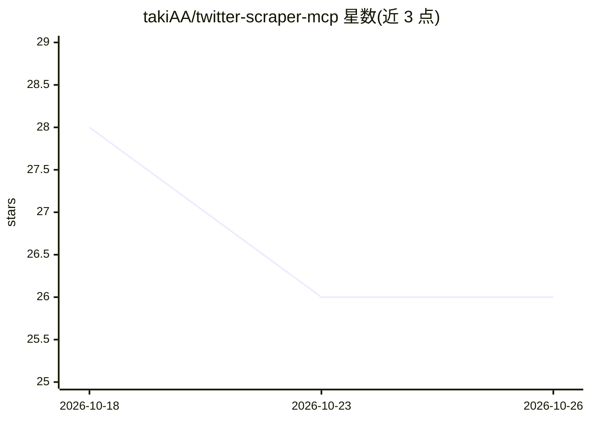

# takiAA/twitter-scraper-mcp

⭐ 26 · JavaScript · MIT · 推送 2026-10-23 · [GitHub](https://github.com/takiAA/twitter-scraper-mcp) · 个人维护 · 中文 README

**让 MCP agent 通过本地 X 会话做搜索与推文读取的服务器**

非官方的 Twitter/X MCP 服务器，供 AI agent 接入 X 数据：基于本地 twscrape 会话提供搜索、用户时间线、会话串、资料、书签/列表等 27 个已注册工具，Cookie 存于本机 SQLite 数据库，无需开发者 API key；另有无需会话的公开推文 oEmbed 查询，以及默认关闭、需显式开启的发帖/删帖写入。会话读写不保证全部工具经过实机验证，1.1.0 版本未发布。以源码方式安装（Node 22.19+/Python 3.11+），支持 Docker 运行。

## 筛选速览

| 维度 | 判定 | 备注 |
|---|---|---|
| AI 角色 | `ai-ecosystem` | LLM/agent 周边工具 |
| 许可风险 | `permissive` | MIT |
| 部署形态 | `None` |  |
| 模型依赖 | — | README 未给出锁定关系 |
| 硬件要求 | — | 无带数字的原话,不猜 |
| 安装摩擦 | `low` | 无编译、无系统依赖或容器化 |
| 成熟度 | `idea` | |

## 能力要点

- 基于本地浏览器会话（twscrape）的搜索/时间线/会话串读取，无需开发者 API key
- 默认 getTweet 走公开 oEmbed，无会话无 Python 即可查单条推文
- 写入默认关闭，需三个环境变量显式开启且不自动重试
- 返回 JSON 与 MCP structuredContent，含来源标签、partial/error 状态与分页 token

## 适用场景

- 让 MCP agent 搜索 X 上的话题并返回带来源的结构化结果
- 读取某账号最新推文或某条会话串用于研究分析
- 在受信任的客户端中经显式授权发布/删除纯文本推文

## 场景标签

`网页抓取` · 领域:效率与自动化

## 证据(README 行号)

> L13: Connect an MCP agent to X search, recent user posts, conversations and profiles through twscrape. Keep your session
> L68: Add this stdio server to your MCP client's configuration, replacing the path:
> L73:     "twitter": {

## 星数曲线

2026-10-18 28 → 2026-10-26 26（-2）

---
*卡片 v1 · prompt 1.4 · 生成 2026-10-26 · 置信度 high · 依据 README sha `b544b9b580c9` · [字段定义](../../DATASET.md)*
