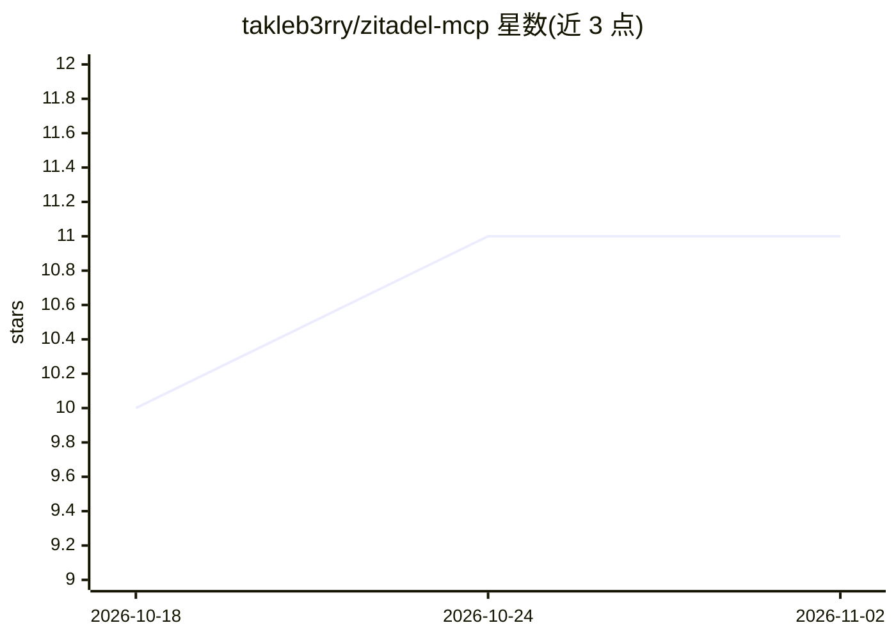

# takleb3rry/zitadel-mcp

⭐ 11 · TypeScript · MIT · 推送 2026-10-31 · [GitHub](https://github.com/takleb3rry/zitadel-mcp) · 个人维护

**让 AI 工具用自然语言管理 Zitadel 身份平台的 MCP 服务器**

一个 MCP (Model Context Protocol) 服务器，向 Claude Code 等 AI 客户端暴露 37 个工具，覆盖 Zitadel 的用户、项目、OIDC 应用、角色、组织管理员、服务账号与登录策略管理。实现标准化两角色 RBAC（admin/standard）与无超级管理员模式，提供原子幂等的用户开通/离职工具。通过服务账号 JSON 密钥认证，角色授权优先走 v2 AuthorizationService 并回退 v1。安全机制包括：客户端密钥不进入对话、私钥写入 600 权限文件、PII 日志脱敏；要求服务账号具备 Org Owner 级权限。安装方式为 git clone 后 npm 构建。

## 筛选速览

| 维度 | 判定 | 备注 |
|---|---|---|
| AI 角色 | `ai-ecosystem` | LLM/agent 周边工具 |
| 许可风险 | `permissive` | MIT |
| 部署形态 | `library` | 以包/库形式分发 |
| 模型依赖 | — | README 未给出锁定关系 |
| 硬件要求 | — | 无带数字的原话,不猜 |
| 安装摩擦 | `low` | 无编译、无系统依赖或容器化 |
| 成熟度 | — | 结构信号不足 |

## 能力要点

- 37 个工具覆盖用户/项目/应用/角色/服务账号/登录策略管理
- 标准化两角色模型（admin/standard）+ ORG_USER_MANAGER 的无超级管理员模式
- 幂等的原子开通（provision）与离职（offboard）工具
- 客户端密钥与私钥不进入 AI 对话，PII 日志脱敏

## 适用场景

- 让开发者通过自然语言在 Zitadel 中开通/离职用户并分配角色
- 在 AI 工具里创建和配置 OIDC 应用与项目
- 覆盖 Login V2 的本地化登录文案

## 场景标签

 · 领域:身份与访问管理（IAM）/AI 工具集成

## 证据(README 行号)

> L3: An MCP (Model Context Protocol) server for Zitadel identity management. Manage users, projects, applications, roles,
> L105: - **Global** (all projects): `~/.claude.json` under the `"mcpServers"` key

## 星数曲线

2026-10-18 10 → 2026-11-02 11（+1）

---
*卡片 v1 · prompt 1.4 · 生成 2026-11-01 · 置信度 high · 依据 README sha `b3b40368ddac` · [字段定义](../../DATASET.md)*
