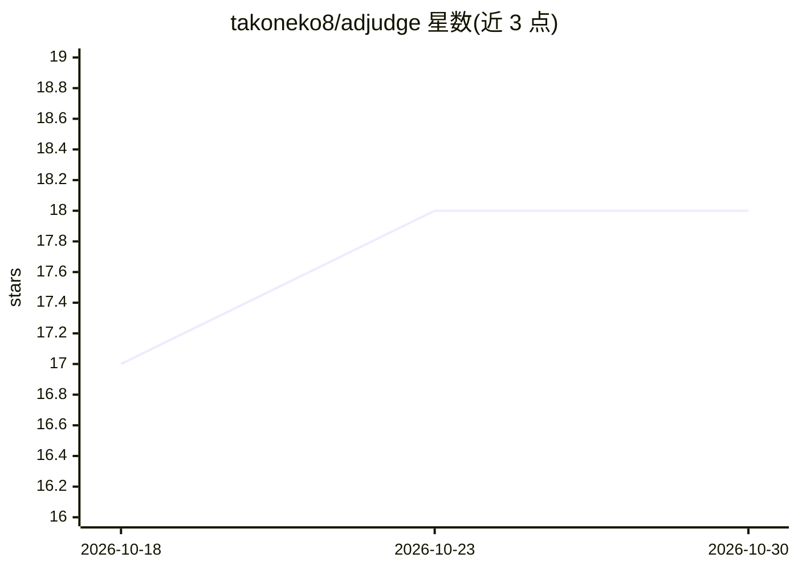

# takoneko8/adjudge

⭐ 18 · Python · MIT · 推送 2026-06-26 · [GitHub](https://github.com/takoneko8/adjudge) · 个人维护

**安全扫描器输出的 AI 去噪分诊工具：去重、关联、标注核验裁决**

读取 nuclei、semgrep/CodeQL SARIF、Trivy、gitleaks、httpx 等扫描器输出，统一为单一发现模型后去重、跨工具关联，再用 LLM 仅做真/假阳性分类，每条发现标注 TOOL-CONFIRMED、AI-INFERRED 或 COULD-NOT-VERIFY，可溯源到源码行。核心分析路径不发包；verify/scan 为可选并受 scope 约束，破坏性类别被硬阻断。面向渗透测试者、漏洞赏金猎人与 AppSec 工程师，以 pip/pipx/uvx 安装的 Python CLI 提供，LLM 供应商无关（OpenAI/Anthropic/Gemini/OpenRouter 或兼容端点）。

## 筛选速览

| 维度 | 判定 | 备注 |
|---|---|---|
| AI 角色 | `ai-ecosystem` | LLM/agent 周边工具 |
| 许可风险 | `permissive` | MIT |
| 部署形态 | `library` | 以包/库形式分发 |
| 模型依赖 | locked-api |  |
| 硬件要求 | — | 无带数字的原话,不猜 |
| 安装摩擦 | `low` | 无编译、无系统依赖或容器化 |
| 成熟度 | — | 结构信号不足 |

## 能力要点

- 五种扫描器格式的 JSON 适配器与单一严重度模型
- LLM 仅做分类不选择动作，全部工具文本按不可信输入消毒
- 每条发现可溯源至源码行，附 sha256 溯源清单（模型、prompt 哈希、成本）
- 每运行 USD 成本上限与 fail-loud 机制

## 适用场景

- 把多个扫描器的大量输出整理为可交付客户的去噪报告
- 漏洞赏金提交前确认发现真实性并导出 HackerOne 提交块
- 在 CI 中接入扫描器并基于可信 SARIF 门禁

## 场景标签

`网络安全` · 领域:学习与行业

## 证据(README 行号)

> L78: 4. **LLM false-positive triage** — the model classifies likely-real vs likely-false. It classifies *only*; it never
> L162: Adjudge is **LLM-agnostic** — OpenAI, Anthropic, Gemini, OpenRouter, or any OpenAI-compatible endpoint. Set one pr

## 星数曲线

2026-10-18 17 → 2026-10-30 18（+1）

---
*卡片 v1 · prompt 1.4 · 生成 2026-10-29 · 置信度 high · 依据 README sha `9f49deb1bc9c` · [字段定义](../../DATASET.md)*
