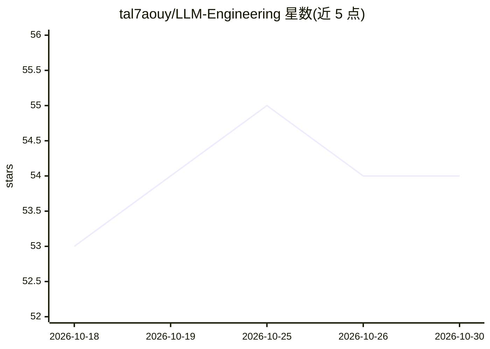

# tal7aouy/LLM-Engineering

⭐ 54 · Jupyter Notebook · MIT · 推送 2026-09-05 · [GitHub](https://github.com/tal7aouy/LLM-Engineering) · 个人维护

**24 周 LLM 工程师学习路线图：从基础到生产级**

由个人开发者维护的 LLM 工程学习路线图，以 24 周、每天 2 小时的自学节奏组织，覆盖基础 ML 概念、提示工程、RAG、自主 agent、部署与安全等阶段，每个阶段附概念表、工具清单、项目与资源链接。2026 增补版纳入 MCP、推理模型、A2A 协议、后训练、量化等专题。内容为文档形式，主要语言 Python，前提是掌握基础 Python、REST API 与 Git。

## 筛选速览

| 维度 | 判定 | 备注 |
|---|---|---|
| AI 角色 | `ai-knowledge` | 知识聚合/清单类 |
| 许可风险 | `permissive` | MIT |
| 部署形态 | `self-host` | docker 或自建部署 |
| 模型依赖 | — | README 未给出锁定关系 |
| 硬件要求 | — | 无带数字的原话,不猜 |
| 安装摩擦 | `low` | 无编译、无系统依赖或容器化 |
| 成熟度 | — | 结构信号不足 |

## 能力要点

- 6 个阶段（共 24 周）覆盖基础、应用、RAG、Agent 等主题
- 每阶段提供概念表、工具安装命令、练手项目与资源链接
- 含 LLM 应用栈、RAG 管线、Agent 循环的架构图示
- 2026 增补 MCP、推理模型、A2A、后训练、量化等专题

## 适用场景

- 按周计划自学成为 LLM 工程师
- 查找各阶段的工具与学习资源
- 了解 RAG 与 Agent 系统的组件构成

## 场景标签

`教程课程` · 领域:学习与行业

## 证据(README 行号)

> L29: This roadmap takes you from **beginner to production-grade LLM Engineer** in 24 weeks. It covers foundational ML co
> L33: |Total Duration|24 weeks (self-paced)|

## 星数曲线

2026-10-18 53 → 2026-10-30 54（+1）

---
*卡片 v1 · prompt 1.4 · 生成 2026-10-24 · 置信度 mid · 依据 README sha `64da365cb3a2` · [字段定义](../../DATASET.md)*
