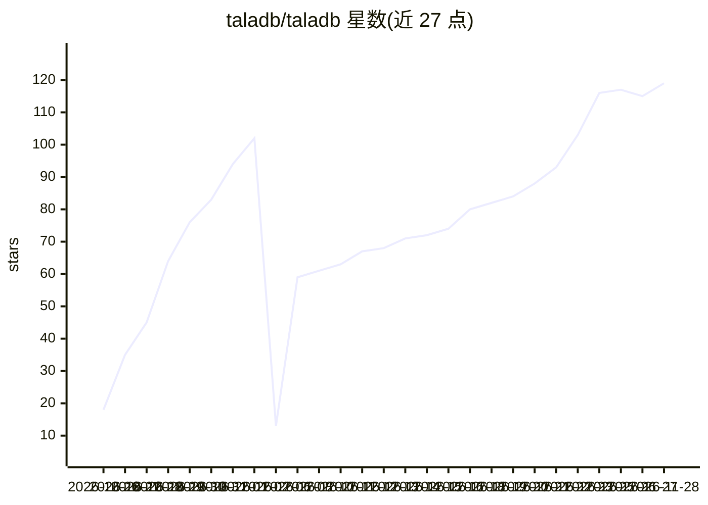

# taladb/taladb

⭐ 119 · Rust · Apache-2.0 · 推送 2026-11-22 · [GitHub](https://github.com/taladb/taladb) · [官网](https://taladb.dev) · 组织维护

**内嵌式文档与向量数据库：支撑本地优先 AI 应用**

以 Rust 为核心的内嵌数据库，在应用进程内存储 JSON 文档与向量嵌入，无服务器、无云端往返。查询接口采用 MongoDB 风格过滤与二级索引，支持精确 k-NN 与可选 HNSW 向量检索、BM25 全文检索及 RRF 混合检索，写入具备 ACID 事务，可选 AES-GCM-256 静态加密，并提供实时订阅查询与数据迁移。同一 Rust 内核通过 WebAssembly、napi-rs、JNI、C FFI 等绑定运行于浏览器、Node.js、React Native、Android、iOS、macOS 与 Rust。MIT OR Apache-2.0 双许可。

## 筛选速览

| 维度 | 判定 | 备注 |
|---|---|---|
| AI 角色 | `ai-ecosystem` | LLM/agent 周边工具 |
| 许可风险 | `permissive` | Apache-2.0 |
| 部署形态 | `library` | 以包/库形式分发 |
| 模型依赖 | — | README 未给出锁定关系 |
| 硬件要求 | — | 无带数字的原话,不猜 |
| 安装摩擦 | `low` | 无编译、无系统依赖或容器化 |
| 成熟度 | — | 结构信号不足 |

## 能力要点

- 单引擎同时存储 JSON 文档与向量嵌入，进程内运行无服务器
- 向量 k-NN（cosine/dot/euclidean）、可选 HNSW、BM25 与 RRF 混合检索
- ACID 事务（基于 redb）、可选 AES-GCM-256 静态加密、实时订阅查询
- 六平台包（浏览器/Node/React Native/Android/iOS/macOS/Rust）共享同一 Rust 内核

## 适用场景

- 本地优先的移动端或浏览器应用离线存储与检索数据
- 为端侧 AI 应用提供向量检索与混合搜索能力
- 在无后端场景下用 webhook 将本地变更推送给服务端

## 场景标签

`向量数据库` `语义搜索` · 领域:知识与检索

## 证据(README 行号)

> L21: TalaDB stores JSON documents and their vector embeddings in one embedded engine. You
> L62: - **Vector search.** Exact k-NN (cosine, dot, euclidean) by default, optional HNSW, and
> L64: - **Full-text and hybrid search.** BM25 ranking with `searchText`, and `hybridSearch`

## 星数曲线

2026-10-26 18 → 2026-11-28 119（+101）

---
*卡片 v1 · prompt 1.4 · 生成 2026-11-28 · 置信度 high · 依据 README sha `e4b01713df45` · [字段定义](../../DATASET.md)*
