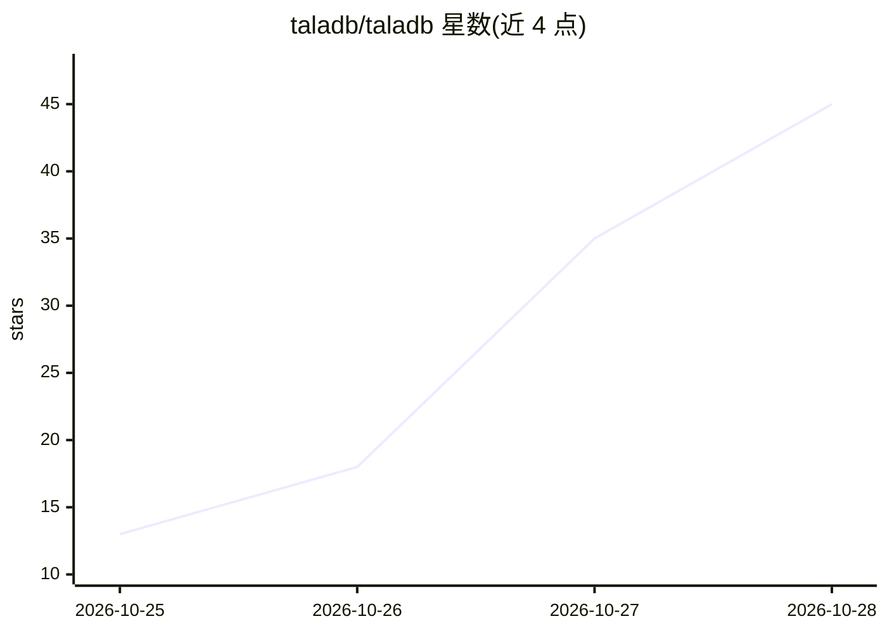

# taladb/taladb

⭐ 64 · Rust · Apache-2.0 · 推送 2026-10-28 · [GitHub](https://github.com/taladb/taladb) · [官网](https://taladb.dev) · 组织维护

**面向本地优先 AI 应用的嵌入式文档+向量数据库**

以同一 Rust 内核驱动的嵌入式数据库，将 JSON 文档存储、元数据过滤与向量相似度检索合并到一个引擎中，覆盖浏览器（WASM/OPFS）、Node.js、React Native、Android（Kotlin）与 iOS/macOS（Swift），无需服务端。提供 BM25 全文检索、倒排秩融合的混合检索、过滤优先的向量搜索、ACID 事务、live queries 与变更 webhook，可配合 transformers.js、ONNX Runtime Web 等端侧嵌入模型使用。限制：不做复制，webhook 仅由 TypeScript 客户端投递且至多一次。

## 筛选速览

| 维度 | 判定 | 备注 |
|---|---|---|
| AI 角色 | `ai-ecosystem` | LLM/agent 周边工具 |
| 许可风险 | `permissive` | Apache-2.0 |
| 部署形态 | `library` | 以包/库形式分发 |
| 模型依赖 | — | README 未给出锁定关系 |
| 硬件要求 | — | 无带数字的原话,不猜 |
| 安装摩擦 | `low` | 无编译、无系统依赖或容器化 |
| 成熟度 | — | 结构信号不足 |

## 能力要点

- 文档+向量单引擎，同一 Rust 内核跨浏览器/Node/RN/Kotlin/Swift
- 精确 k-NN 向量搜索（cosine/dot/euclidean）+ 可选 HNSW
- BM25 全文检索与 RRF 混合检索，元数据过滤先于排序
- ACID 事务（redb）、live queries、静态加密与 schema 迁移

## 适用场景

- 离线/本地优先应用中做语义与关键词混合检索
- 端侧 RAG：与 transformers.js 等本地嵌入模型搭配构建检索层
- 移动应用（Android/iOS）内嵌文档与向量存储，无需后端数据库
- 本地写入后通过 webhook 通知后端系统

## 场景标签

`向量数据库` · 领域:知识与检索

## 证据(README 行号)

> L3: **An open-source embedded vector and document database for building local-first AI applications.**
> L19: TalaDB combines a document database and a vector database in one embedded engine. Store JSON-like documents, query 

## 星数曲线

2026-10-25 13 → 2026-10-28 45（+32）

---
*卡片 v1 · prompt 1.4 · 生成 2026-10-27 · 置信度 high · 依据 README sha `d535a789aaca` · [字段定义](../../DATASET.md)*
