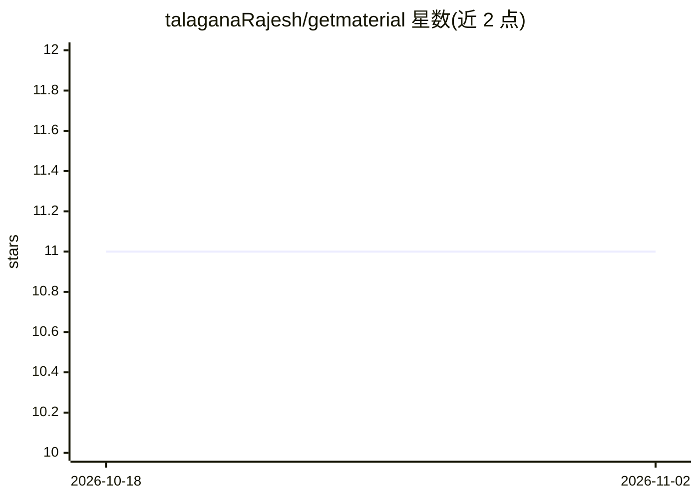

# talaganaRajesh/getmaterial

⭐ 11 · JavaScript · 推送 2026-10-20 · [GitHub](https://github.com/talaganaRajesh/getmaterial) · [官网](https://getmaterial.vercel.app) · 个人维护

**面向 NIST 学生的笔记共享网站：学长上传、学生浏览下载**

GetMaterial 是一个面向 NIST 学生群体的协作式笔记共享平台：高年级学生可为各科目上传笔记，低年级与同届学生可搜索并下载学习资料，界面适配移动端与桌面端。技术栈为 ReactJS 与 Tailwind CSS 前端、Node.js 与 Express.js 后端、Firebase 数据库，部署于 Vercel。README 提供 git clone 源码方式获取项目；未在 README 中描述任何 AI 功能，主题标签含 ai 但正文无可验证的 AI 机制说明。

## 筛选速览

| 维度 | 判定 | 备注 |
|---|---|---|
| AI 角色 | `ai-knowledge` | 知识聚合/清单类 |
| 许可风险 | `none` | — |
| 部署形态 | `None` |  |
| 模型依赖 | — | README 未给出锁定关系 |
| 硬件要求 | — | 无带数字的原话,不猜 |
| 安装摩擦 | `low` | 无编译、无系统依赖或容器化 |
| 成熟度 | — | 结构信号不足 |

## 能力要点

- 学长上传各科目笔记，学生搜索下载
- 移动端与桌面端自适应界面
- ReactJS + Express + Firebase 技术栈，部署于 Vercel

## 适用场景

- 学长向学弟学妹分享课程笔记
- 学生按科目查找并下载学习资料

## 场景标签

 · 领域:教育/笔记共享

## 证据(README 行号)

> L3: **A collaborative notes-sharing platform for NIST students.**
> L4: GetMaterial allows students to access notes shared by their seniors, fostering a supportive academic community. 📚

## 星数曲线

2026-10-18 11 → 2026-11-02 11（+0）

---
*卡片 v1 · prompt 1.4 · 生成 2026-11-01 · 置信度 low · 依据 README sha `b81cf55ebe9c` · [字段定义](../../DATASET.md)*
