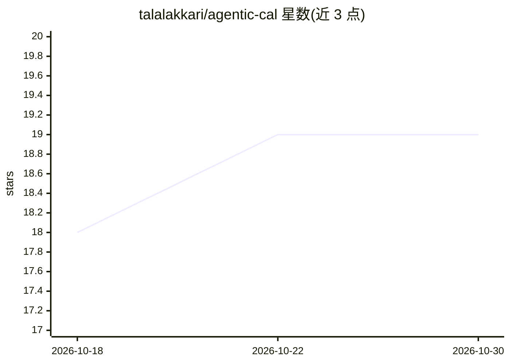

# talalakkari/agentic-cal

⭐ 19 · TypeScript · Apache-2.0 · 推送 2026-10-10 · [GitHub](https://github.com/talalakkari/agentic-cal) · [官网](https://talalakkari.com) · 个人维护

**自托管邮件+日历聚合中心，带 AI 助手与 MCP 服务**

部署在 Cloudflare Workers 上的邮件与日历中心：完整自托管邮件客户端（收发、富文本、附件、每个邮箱独立 Durable Object），聚合 Proton/Outlook/iCloud 的 ICS 订阅链接为统一忙闲模型，写路径通过 RFC 5546/6047 标准邮件邀请回写三家日历，无需 OAuth/CalDAV/厂商 API。内置 AI 助手（Workers AI + AI Gateway，19 工具，自动起草回复需人工确认），并通过 /mcp 对 Claude Code 等外部 agent 暴露工具（Access 服务令牌认证，单一信任边界，无按邮箱授权）。一键部署按钮加手动配置 Access、AI Gateway、Email Routing 等步骤。

## 筛选速览

| 维度 | 判定 | 备注 |
|---|---|---|
| AI 角色 | `ai-native` | 本体是模型或模型工具 |
| 许可风险 | `permissive` | Apache-2.0 |
| 部署形态 | `library` | 以包/库形式分发 |
| 模型依赖 | — | README 未给出锁定关系 |
| 硬件要求 | — | 无带数字的原话,不猜 |
| 安装摩擦 | `low` | 无编译、无系统依赖或容器化 |
| 成熟度 | — | 结构信号不足 |

## 能力要点

- 聚合三家日历 ICS 为统一忙闲模型，经 iMIP 邮件邀请回写，无需 OAuth/CalDAV
- /mcp 暴露 23 个工具供 Claude Code 等 MCP 客户端调用
- 内置 AI 助手自动起草回复，发送前需确认；邮件内容以数据围栏隔离防注入
- Fork 自 cloudflare/agentic-inbox，Apache 2.0

## 适用场景

- 用自己的域名收发邮件并获得 AI 起草回复
- 把 Proton/Outlook/iCloud 三个日历合并查看忙闲并统一屏蔽时间
- 让 Claude Code 等 MCP agent 查询可用时间并代为创建时间块

## 场景标签

`AI 助手` · 领域:对话与助手

## 证据(README 行号)

> L19: - **Built-in AI agent.** Chat panel with a 19-tool surface (9 email + 10 calendar, overlapping but not identical to
> L18: - **MCP server.** `/mcp` behind Cloudflare Access exposes **23 tools** (13 email + 10 calendar: `get_availability`,

## 星数曲线

2026-10-18 18 → 2026-10-30 19（+1）

---
*卡片 v1 · prompt 1.4 · 生成 2026-10-28 · 置信度 high · 依据 README sha `9b1e4aea8703` · [字段定义](../../DATASET.md)*
