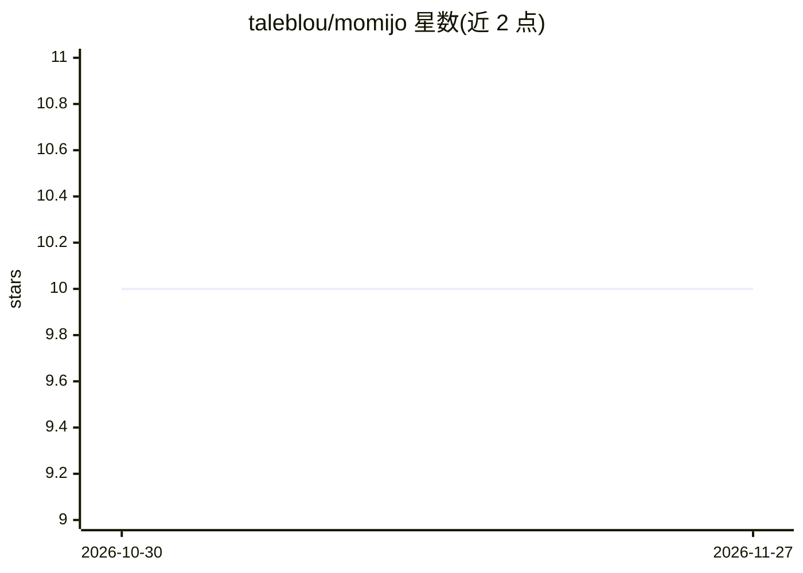

# taleblou/momijo

⭐ 10 · Mojo · MIT · 推送 2026-11-21 · [GitHub](https://github.com/taleblou/momijo) · 个人维护

**Mojo 编写的机器学习/张量计算库，面向 AI 与数据科学**

用 Mojo 编写的开源 AI 与数值计算项目，目标是构建从张量计算到模型训练与推理的完整框架。当前源码快照包含两个独立的张量引擎（tensor 与 tensor_light）、测试、示例与基准程序源码；深度学习框架（learn）、dataframe、vision、visual 均为预留命名空间，未实现。要求 Pixi 与 Modular/conda 渠道、钉定的 Mojo 1.1.0 与 MAX 26.6.0 工具链；README 明确声明编译与运行时正确性尚未验证，PyTorch 替代仅为长期目标。

## 筛选速览

| 维度 | 判定 | 备注 |
|---|---|---|
| AI 角色 | `ai-native` | 本体是模型或模型工具 |
| 许可风险 | `permissive` | MIT |
| 部署形态 | `None` |  |
| 模型依赖 | — | README 未给出锁定关系 |
| 硬件要求 | — | 无带数字的原话,不猜 |
| 安装摩擦 | `low` | 无编译、无系统依赖或容器化 |
| 成熟度 | `idea` | |

## 能力要点

- 两个独立的 Mojo 张量引擎（tensor 与 tensor_light），互不导入对方实现
- 提供测试、示例与 CPU 基准程序源码
- 路线图覆盖 autograd、训练框架、vision/dataframe 等规划阶段
- MIT 许可，仓库仅含 .mojo 代码

## 适用场景

- 在 Mojo 生态中进行张量运算与数值计算实验
- 跟踪/参与早期 Mojo 深度学习框架的开发与验证
- 对张量引擎实现与基准方法学进行研究

## 场景标签

 · 领域:机器学习/深度学习框架

## 证据(README 行号)

> L20: **Momijo** is an open-source artificial intelligence and numerical computing project written in **Mojo**. Its long-
> L44: |`momijo.tensor`|**Source present**|General-purpose tensor engine: storage, shape, indexing/views, operations, exec
> L50: |Mojo compilation and full runtime test pass|**Not verified in this review**|Requires the pinned Mojo/MAX toolchain

## 星数曲线

2026-10-30 10 → 2026-11-27 10（+0）

---
*卡片 v1 · prompt 1.4 · 生成 2026-11-19 · 置信度 high · 依据 README sha `d890c42925c2` · [字段定义](../../DATASET.md)*
