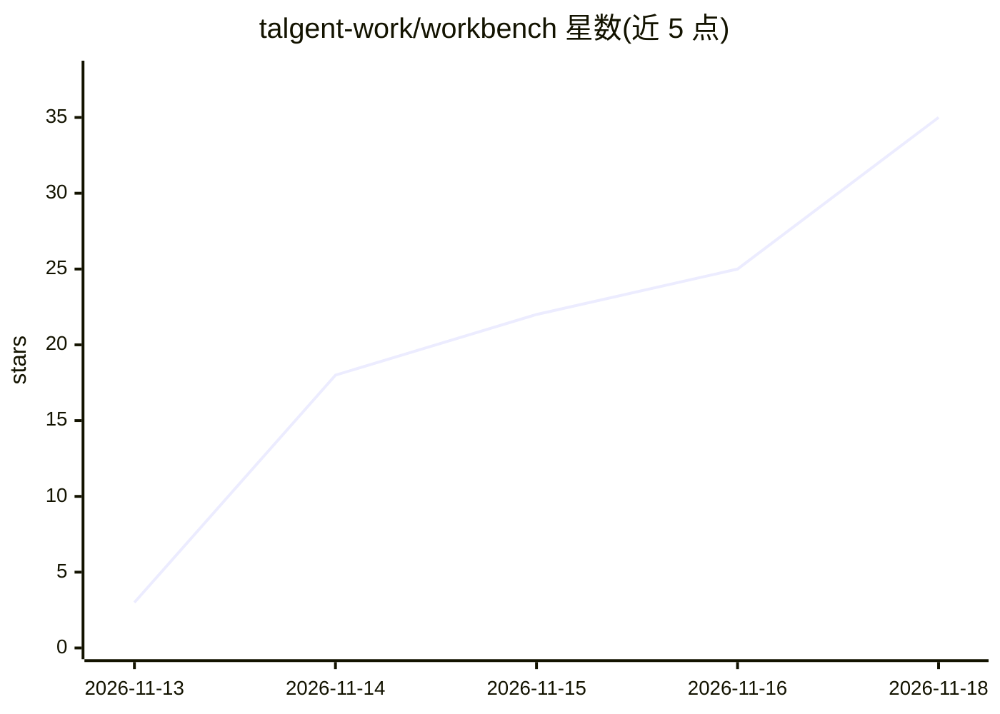

# talgent-work/workbench

⭐ 35 · Go · Apache-2.0 · 推送 2026-11-13 · [GitHub](https://github.com/talgent-work/workbench) · [官网](https://talgent.work) · 组织维护

**自托管的托管式 AI Agent 平台，每个任务独立沙箱运行**

Talgent Workbench 是一个部署在自有 Kubernetes 集群上的托管 Agent 平台：每个人或注册的应用程序拥有自己的 Agent，以 Work 为单位接受任务、附加文件并收集产物。平台原生运行 Claude Code，支持 Claude、DeepSeek、Qwen、Kimi、GLM、MiniMax 等任何 Anthropic 兼容 API 的模型。每个 Work 可运行在 VM 隔离的集群沙箱，或通过 npm 安装 @talgent/computer 连接自己的 Mac/Linux/Windows 机器。提供会话恢复、插件市场、OAuth 2.0 应用接入与按人/Work/模型的 token 用量统计。另有上层产品 Talgent Orchestra 做跨团队协调。

## 筛选速览

| 维度 | 判定 | 备注 |
|---|---|---|
| AI 角色 | `ai-ecosystem` | LLM/agent 周边工具 |
| 许可风险 | `permissive` | Apache-2.0 |
| 部署形态 | `None` |  |
| 模型依赖 | — | README 未给出锁定关系 |
| 硬件要求 | — | 无带数字的原话,不猜 |
| 安装摩擦 | `low` | 无编译、无系统依赖或容器化 |
| 成熟度 | — | 结构信号不足 |

## 能力要点

- 原生运行 Claude Code，兼容任意 Anthropic 兼容 API 模型
- 每个 Work 独立 VM 隔离沙箱，或经 Talgent Computer 在本机运行
- Web 应用与公共 API 双入口，应用程序可注册并驱动 Agent
- 按人、Work、模型和应用的 token 用量追踪

## 适用场景

- 在自己集群上给每个员工部署专属 AI Agent 处理实际工作
- 让自有产品通过 API 驱动 Agent 完成任务并收集产物
- 需要数据与会话都留在自有基础设施内的 Agent 平台

## 场景标签

`编码 Agent` · 领域:编码与开发

## 证据(README 行号)

> L20: Workbench runs Claude Code natively and hosts everything around it: a sandbox per Work, sessions
> L29: - **Any model, per Work.** Offer Claude, DeepSeek, Qwen, Kimi, GLM, MiniMax or any vendor with an
> L82: Register an **Application** and your own systems or product drive Agents through the same public

## 星数曲线

2026-11-13 3 → 2026-11-18 35（+32）

---
*卡片 v1 · prompt 1.4 · 生成 2026-11-18 · 置信度 high · 依据 README sha `eb31af4d8aba` · [字段定义](../../DATASET.md)*
