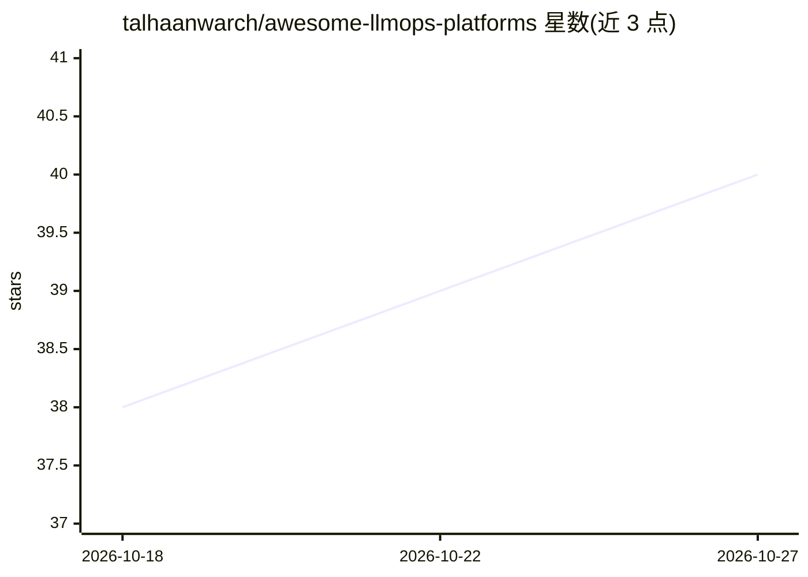

# talhaanwarch/awesome-llmops-platforms

⭐ 40 · Python · CC0-1.0 · 推送 2026-10-26 · [GitHub](https://github.com/talhaanwarch/awesome-llmops-platforms) · 个人维护

**开源 LLMOps 工具策展清单：144 个可自托管工具按周刷新**

收录 144 个可自行运行的开源 LLMOps 工具的 awesome 清单，按追踪、评测、网关、护栏与提示管理分类组织，各表按 GitHub 星数降序排列，由 GitHub Action 每周刷新星数、许可证与最后推送日期。明确排除论文、课程、模型基准与 agent 框架。标注归档/失活项目状态，面向为生产环境 LLM 应用选型的开发与运维人员。

## 筛选速览

| 维度 | 判定 | 备注 |
|---|---|---|
| AI 角色 | `ai-knowledge` | 知识聚合/清单类 |
| 许可风险 | `viral` | CC0-1.0 |
| 部署形态 | `None` |  |
| 模型依赖 | — | README 未给出锁定关系 |
| 硬件要求 | — | 无带数字的原话,不猜 |
| 安装摩擦 | `low` | 无编译、无系统依赖或容器化 |
| 成熟度 | — | 结构信号不足 |

## 能力要点

- 收录 144 个可自托管 LLMOps 工具
- GitHub Action 每周自动刷新星数、许可证与日期
- 按 All-in-one 平台、可观测性、评测、红队、护栏、网关等类别组织
- 标注 archived / inactive 项目状态与许可证信息

## 适用场景

- 为 LLM 应用挑选追踪与可观测性工具
- 比较评测框架与红队/安全测试工具
- 查找自托管 LLM 网关与护栏方案

## 场景标签

`精选清单` · 领域:学习与行业

## 证据(README 行号)

> L3: A curated list of **144 open-source tools for running LLM applications in production**: tracing, evaluation, gateway
> L7: This list covers tools you can run yourself. It leaves out papers, courses, model benchmarks and agent frameworks. O

## 星数曲线

2026-10-18 38 → 2026-10-27 40（+2）

---
*卡片 v1 · prompt 1.4 · 生成 2026-10-25 · 置信度 high · 依据 README sha `9b806cb2f474` · [字段定义](../../DATASET.md)*
