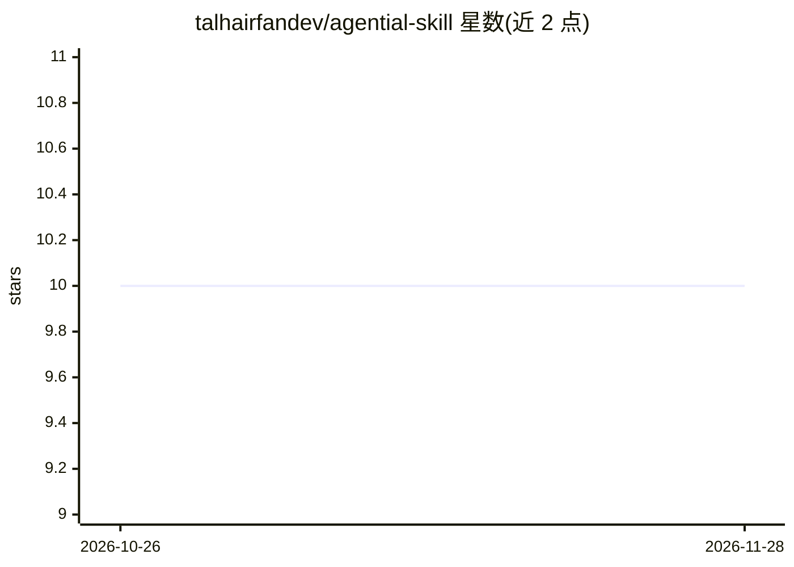

# talhairfandev/agential-skill

⭐ 10 · JavaScript · MIT · 推送 2026-09-22 · [GitHub](https://github.com/talhairfandev/agential-skill) · [官网](https://agential-skill-webapp.vercel.app/) · 个人维护

**为 AI 编码代理注入编辑部级前端 UI 设计规范的技能包**

一个通过 npm 安装的 skill（SKILL.md 格式），向 Claude Code、Google Antigravity、VS Code (GitHub Copilot)、Cursor、Windsurf 等 AI 编码工具写入设计规范与平台适配文件，使生成的 UI 从通用 SaaS 卡片风格转为以图像排版、超大字体、1px 构造网格、有限配色为核心的编辑部式风格。包含五大支柱（记忆、输出、纪律、增量交付、事后校验）、DESIGN.md 令牌契约与 Web LLM 通用系统提示，并提供 React/Next.js 与 Vue/Nuxt 框架指引。

## 筛选速览

| 维度 | 判定 | 备注 |
|---|---|---|
| AI 角色 | `ai-ecosystem` | LLM/agent 周边工具 |
| 许可风险 | `permissive` | MIT |
| 部署形态 | `library` | 以包/库形式分发 |
| 模型依赖 | — | README 未给出锁定关系 |
| 硬件要求 | — | 无带数字的原话,不猜 |
| 安装摩擦 | `low` | 无编译、无系统依赖或容器化 |
| 成熟度 | — | 结构信号不足 |

## 能力要点

- npx 一条命令向当前项目安装 skill 与多平台适配文件
- 五平台适配：Claude Code/Antigravity/Copilot/Cursor/Windsurf
- DESIGN.md 机器可读令牌契约 + SKILL.md 完整规范 + AGENTS.md 操作规则
- 内置 WCAG 2.1 AA 语义、事后 diff 检查与变更后校验流程

## 适用场景

- 让 Claude Code / Copilot 生成的前端页面摆脱模板化 SaaS 风格
- 在多个 AI 编码工具间保持统一的视觉输出语言
- 为已有项目追加 React/Next.js 或 Vue/Nuxt 的实现指引

## 场景标签

`提示工程` · 领域:Agent 开发

## 证据(README 行号)

> L8: Specialized for **Claude Code** · **Google Antigravity** · **VS Code (GitHub Copilot)**
> L35: AI coding models often generate generic SaaS UI: soft cards, shadows, glass panels, gradient buttons, dashboard wid
> L56: `DESIGN.md` contains the machine-readable token contract. `SKILL.md` is the complete specification. `AGENTS.md` is 

## 星数曲线

2026-10-26 10 → 2026-11-28 10（+0）

---
*卡片 v1 · prompt 1.4 · 生成 2026-11-19 · 置信度 high · 依据 README sha `78c3aadf0654` · [字段定义](../../DATASET.md)*
