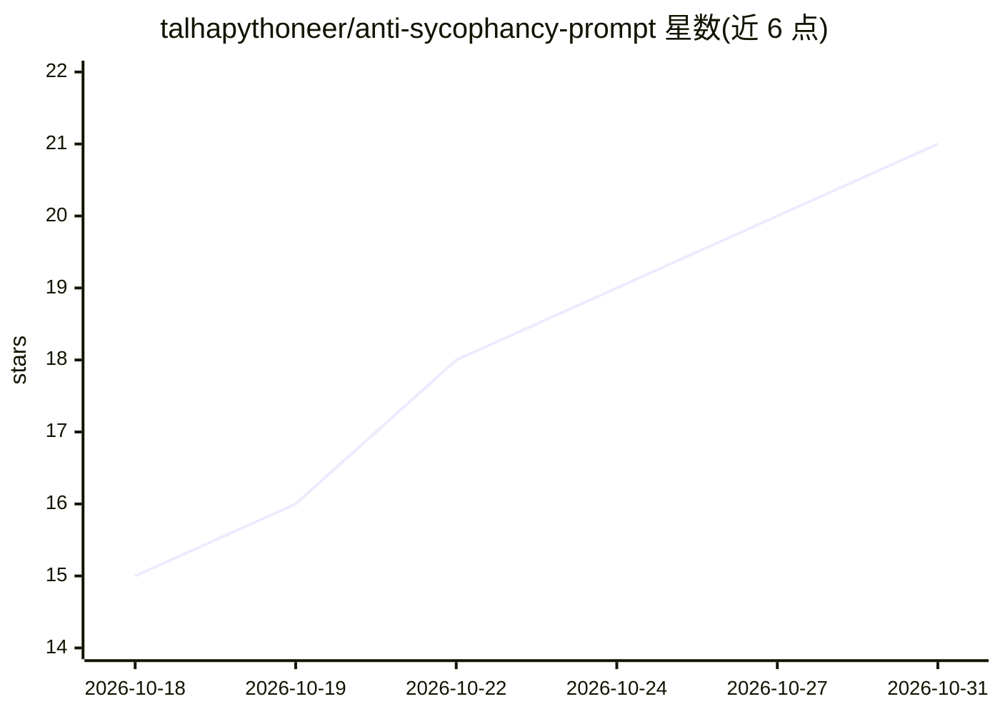

# talhapythoneer/anti-sycophancy-prompt

⭐ 21 · MIT · 推送 2026-09-16 · [GitHub](https://github.com/talhapythoneer/anti-sycophancy-prompt) · 个人维护

**抑制 AI 谄媚行为的系统提示词，附 42 条来源文献**

提供一个可粘贴到任意系统提示词/自定义指令区的 prompt.md 文件，用于改变大模型默认的迎合行为：按内容判断而非立场、即时纠正事实错误、在反复反驳下坚持立场、对重大决策先做压力测试、跟踪自身长期对话中的迎合倾向，并支持默认严格审视与 just execute 直接执行两种模式。模型无关，适用于 Claude Projects、ChatGPT 自定义指令等。附带 42 条来源清单（研究论文、新闻报道、公司声明），出处为 Wikipedia 关于 AI 谄媚的参考文献列表，另存于 sources.md。许可声明为可自由使用、fork、修改且无需署名。

## 筛选速览

| 维度 | 判定 | 备注 |
|---|---|---|
| AI 角色 | `ai-knowledge` | 知识聚合/清单类 |
| 许可风险 | `permissive` | MIT |
| 部署形态 | `None` |  |
| 模型依赖 | — | README 未给出锁定关系 |
| 硬件要求 | — | 无带数字的原话,不猜 |
| 安装摩擦 | `low` | 无编译、无系统依赖或容器化 |
| 成熟度 | — | 结构信号不足 |

## 能力要点

- 单文件 prompt.md，粘贴即用于任意系统提示词字段，模型无关
- 覆盖纠错、坚持立场、决策压力测试、长对话迎合漂移自查等行为规则
- 支持全审视/直接执行（just execute）两种模式切换
- 42 条来源清单独立存于 sources.md

## 适用场景

- 在 ChatGPT/Claude 自定义指令中抑制模型一味附和
- 长对话中防止模型立场漂移回迎合状态
- 重大决策前让模型先做压力测试而非直接认可

## 场景标签

`提示工程` · 领域:Agent 开发

## 证据(README 行号)

> L3: A system prompt against AI sycophancy, built on 42 sources: research papers, journalism, and company statements abou
> L13: Paste `prompt.md` into a system prompt, project instructions, or custom instructions field. It changes how the mode
> L26: ## Sources

## 星数曲线

2026-10-18 15 → 2026-10-31 21（+6）

---
*卡片 v1 · prompt 1.4 · 生成 2026-10-28 · 置信度 high · 依据 README sha `effc5a63233c` · [字段定义](../../DATASET.md)*
