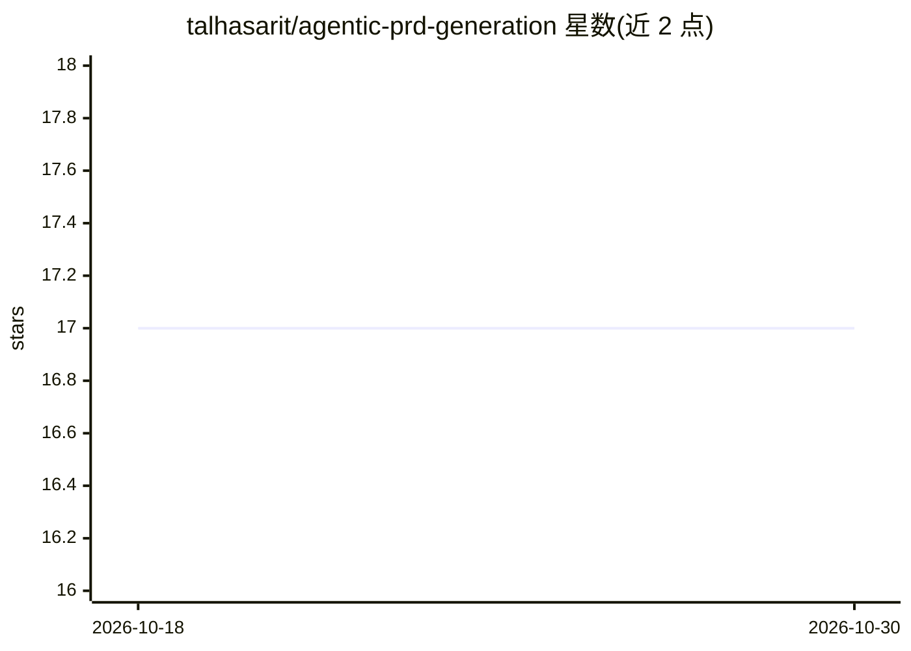

# talhasarit/agentic-prd-generation

⭐ 17 · Python · MIT · 推送 2026-08-12 · [GitHub](https://github.com/talhasarit/agentic-prd-generation) · 个人维护

**从项目想法生成产品需求文档（PRD）的 Alpha 阶段应用**

由 FastAPI 后端与 Streamlit 前端组成的应用：输入单个项目想法，经 LLM 流水线生成产品需求文档，并通过 SSE 从后端向前端流式推送状态更新。支持 OpenAI 或 Google GenAI 适配器二选一；运行状态优先持久化到 Redis，无 Redis 时自动回退到内存存储。明确声明为 Alpha 阶段 MVP，CrewAI/AutoGen 等框架适配、监督检查点、技术规格生成尚未实现。以 pip 安装源码方式运行，附 Docker Compose 与质量检查命令。

## 筛选速览

| 维度 | 判定 | 备注 |
|---|---|---|
| AI 角色 | `ai-native` | 本体是模型或模型工具 |
| 许可风险 | `permissive` | MIT |
| 部署形态 | `self-host` | docker 或自建部署 |
| 模型依赖 | — | README 未给出锁定关系 |
| 硬件要求 | — | 无带数字的原话,不猜 |
| 安装摩擦 | `low` | 无编译、无系统依赖或容器化 |
| 成熟度 | `idea` | |

## 能力要点

- 单一项目想法输入生成 PRD
- FastAPI→Streamlit 的 SSE 流式状态更新
- OpenAI / Google GenAI 双适配器可选
- Redis 可用时持久化状态，否则自动回退内存存储

## 适用场景

- 我有一个产品想法，想快速得到一份 PRD 初稿
- 本地跑一个可流式查看生成过程的需求文档工具

## 场景标签

`AI 写作` · 领域:内容生成

## 证据(README 行号)

> L7: - Generate PRDs from a single project idea.
> L9: - Use either the OpenAI adapter or the Google GenAI adapter.

## 星数曲线

2026-10-18 17 → 2026-10-30 17（+0）

---
*卡片 v1 · prompt 1.4 · 生成 2026-10-29 · 置信度 high · 依据 README sha `9a8d1a05c214` · [字段定义](../../DATASET.md)*
