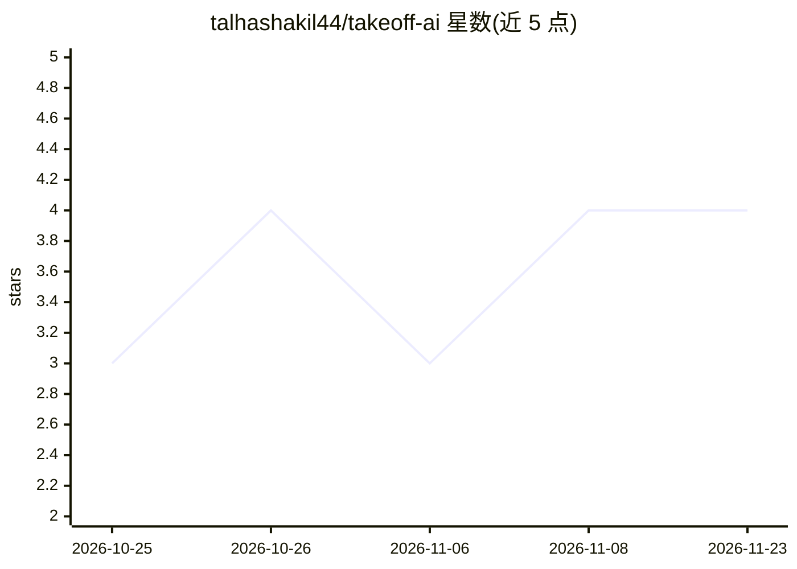

# talhashakil44/takeoff-ai

⭐ 4 · TypeScript · MIT · 推送 2026-11-07 · [GitHub](https://github.com/talhashakil44/takeoff-ai) · [官网](https://github.com/talhashakil44/takeoff-ai/releases/latest) · 个人维护

**给总承包商用的本地运行 AI 建筑图纸算量工具**

面向总承包商/造价人员的建筑图纸算量应用：上传 PDF 图纸后自动读取图纸编号与比例，支持面积/线性/计数测量、装配式公式算量与 Excel 报价工作簿导出。AI 功能包括读取墙/楼/屋面类型图例生成算量类型、按矢量线稿填充房间、按类型标记测量墙体、图例相似区域查找、符号计数、无文字层图纸命名等；图纸与算量数据全部保存在本地浏览器（IndexedDB），不上传服务器。AI 使用用户自己的 Anthropic API key，另提供 Cloudflare Pages 托管的 Web 版与 claude.ai artifact 版。

## 筛选速览

| 维度 | 判定 | 备注 |
|---|---|---|
| AI 角色 | `ai-native` | 本体是模型或模型工具 |
| 许可风险 | `permissive` | MIT |
| 部署形态 | `desktop` | 安装包/桌面程序 |
| 模型依赖 | locked-api |  |
| 硬件要求 | — | 无带数字的原话,不猜 |
| 安装摩擦 | `low` | 无编译、无系统依赖或容器化 |
| 成熟度 | `idea` | |

## 能力要点

- AI 读取图例表自动生成算量类型与装配项，并可与估价师抄写结果对比打分
- 基于 PDF 矢量线稿（非图像模型）的房间填充、按类型墙体测量与相似区域查找
- 全部数据本地存储（IndexedDB/`.takeoff` 文件），无需上传
- 桌面版经 Electron 打包，Web 版可安装为离线应用

## 适用场景

- 从 PDF 图纸集做门窗、墙体、吊顶等分项算量
- 用 AI 读取墙身/屋面图例并批量建立装配算量类型
- 将算量结果导出为投标报价工作簿（Excel）
- 符号类构件（灯具、洁具）整页与全套图纸自动计数

## 场景标签

`文档解析` · 领域:知识与检索

## 证据(README 行号)

> L3: An AI-native construction takeoff tool for general contractors. It runs in your
> L54: - **Read assembly types (done):** on a wall/floor/roof type legend sheet, click
> L79: - **Wall takeoff (done):** on a plan with a scale, **✦ Wall takeoff** measures

## 星数曲线

2026-10-25 3 → 2026-11-23 4（+1）

---
*卡片 v1 · prompt 1.4 · 生成 2026-11-21 · 置信度 high · 依据 README sha `4d8f62ea35f2` · [字段定义](../../DATASET.md)*
