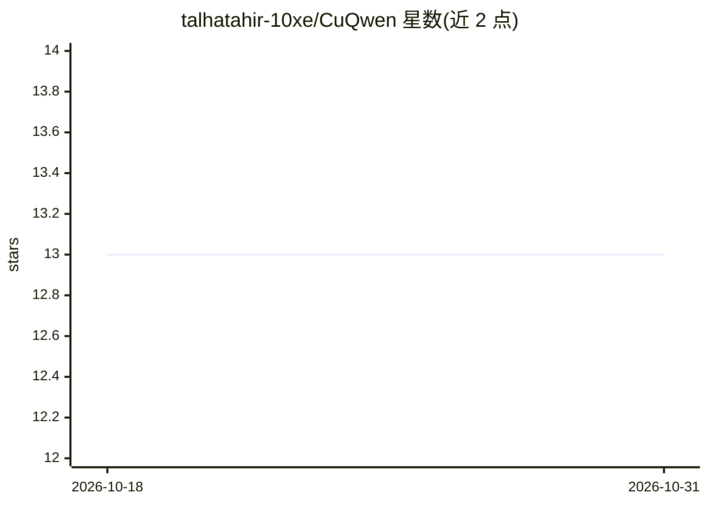

# talhatahir-10xe/CuQwen

⭐ 13 · Cuda · MIT · 推送 2026-10-14 · [GitHub](https://github.com/talhatahir-10xe/CuQwen) · [官网](https://www.linkedin.com/in/talha-tahir-46318420a/) · 个人维护

**从零用 C++/CUDA 编写的 Qwen 模型本地推理引擎**

面向单用户（Batch Size 1）自回归 token 生成的 C++/CUDA 推理引擎，专为本地边缘设备的 NVIDIA GPU 运行开源 Qwen 模型而编写，采用自研优化 CUDA kernel。原生支持 Qwen2.5 系列 0.5B–14B，提供 FP16 与 weights-only INT8/INT4（W8A16/W4A16）三种精度，INT4 可使 Qwen2.5-14B 在 24 GB GPU 上容纳完整 32K FP16 KV cache。需 Linux + CUDA Toolkit 12.0+ 从源码 CMake 编译，也提供 Docker 预配置环境脚本，构建后运行交互式聊天与基准测试。计划支持 Qwen 3.x 系列。

## 筛选速览

| 维度 | 判定 | 备注 |
|---|---|---|
| AI 角色 | `ai-ecosystem` | LLM/agent 周边工具 |
| 许可风险 | `permissive` | MIT |
| 部署形态 | `library` | 以包/库形式分发 |
| 模型依赖 | — | README 未给出锁定关系 |
| 硬件要求 | — | 无带数字的原话,不猜 |
| 安装摩擦 | `high` | 编译与系统依赖俱全 |
| 成熟度 | — | 结构信号不足 |

## 能力要点

- 纯 C++/CUDA 从零实现，针对单用户自回归解码的自定义 CUDA kernel
- 支持 Qwen2.5 0.5B–14B，FP16/INT8/INT4（weights-only 量化）三种精度
- 提供 vs vLLM / llama.cpp 的对比基准测试脚本与多版本性能记录
- Docker 一键预配置环境（setup.sh，含 GPU 直通）

## 适用场景

- 在本地 NVIDIA GPU 上运行 Qwen2.5 模型进行交互式聊天
- 学习/研究自定义 CUDA kernel 与 LLM 推理优化
- 对比自家引擎与 vLLM、llama.cpp 的解码吞吐

## 场景标签

`推理引擎` `模型量化` · 领域:训练与推理

## 证据(README 行号)

> L5: CuQwen is a C++/CUDA inference engine written purely from scratch to explore the theoretical performance limits of s
> L33: CuQwen natively supports the **Qwen2.5** model family across multiple parameter scales, in `fp16` or weights-only `

## 星数曲线

2026-10-18 13 → 2026-10-31 13（+0）

---
*卡片 v1 · prompt 1.4 · 生成 2026-10-31 · 置信度 mid · 依据 README sha `7bc16ae89de8` · [字段定义](../../DATASET.md)*
