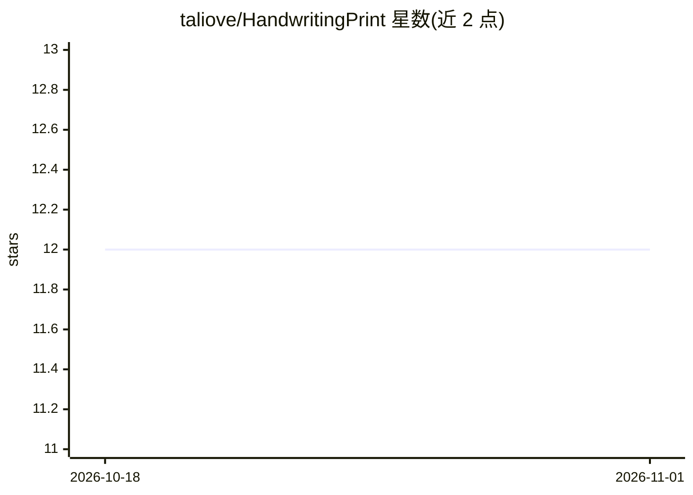

# taliove/HandwritingPrint

⭐ 12 · JavaScript · MIT · 推送 2026-06-26 · [GitHub](https://github.com/taliove/HandwritingPrint) · 个人维护 · 中文 README

**为小学生家长/教师生成带 AI 拼音标注的汉字练习卡 PDF**

基于 Typst 排版引擎与 Node.js 的字帖生成工具：用户以 txt 提供汉字列表，工具提取汉字、调用 OpenAI/Azure OpenAI/国产大模型或 OpenAI 兼容接口生成带声调拼音，再以楷书、行书、隶书等字体和标准田字格布局编译输出可打印 PDF。支持字帖独立配置、多字体批量生成、增量刷新拼音与 AI 不可用时的降级处理；提供命令行交互界面与在线 demo，也可不装 Typst/Node.js 直接在网页端使用。

## 筛选速览

| 维度 | 判定 | 备注 |
|---|---|---|
| AI 角色 | `ai-enhanced` | 去掉 AI 部分产品仍成立 |
| 许可风险 | `permissive` | MIT |
| 部署形态 | `None` |  |
| 模型依赖 | locked-api |  |
| 硬件要求 | — | 无带数字的原话,不猜 |
| 安装摩擦 | `low` | 无编译、无系统依赖或容器化 |
| 成熟度 | — | 结构信号不足 |

## 能力要点

- txt → json → PDF 的字帖生成流程，输出田字格排版练习卡
- AI 拼音标注支持 OpenAI、Azure OpenAI、国产大模型及 OpenAI 兼容接口，AI 不可用时自动降级
- 楷书/行书/隶书等多字体批量编译，文件名自动包含字帖、字体、字数信息
- 字帖 txt 修改后增量刷新，仅对新增汉字生成拼音

## 适用场景

- 为孩子或学生生成某学期生字的田字格练习卡打印
- 同一份字帖一次性生成楷书、行书、隶书多种字体版本
- 不安装本地环境时通过在线 demo 快速生成练习卡

## 场景标签

 · 领域:教育/文档生成

## 证据(README 行号)

> L3: > 基于 Typst 的小学生字练习卡生成工具，支持 AI 智能拼音标注，自动生成带拼音的汉字练习卡片
> L22: - **智能备用方案**：AI 不可用时自动降级处理

## 星数曲线

2026-10-18 12 → 2026-11-01 12（+0）

---
*卡片 v1 · prompt 1.4 · 生成 2026-10-31 · 置信度 high · 依据 README sha `c136a30db8ad` · [字段定义](../../DATASET.md)*
